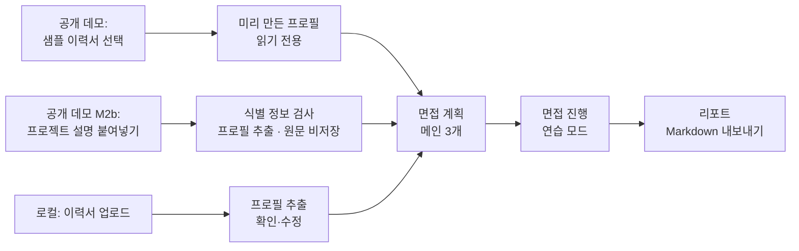
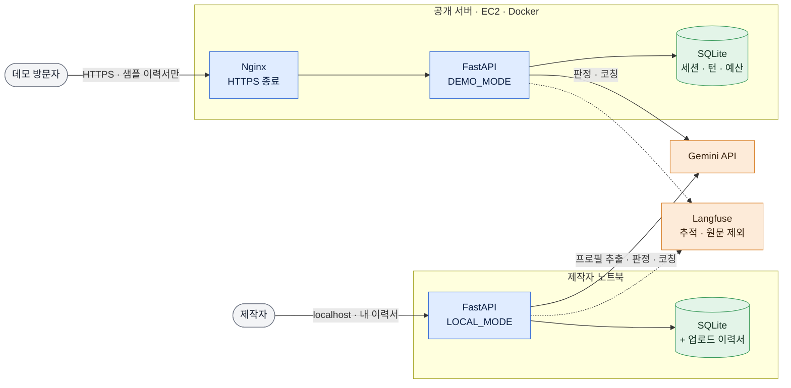
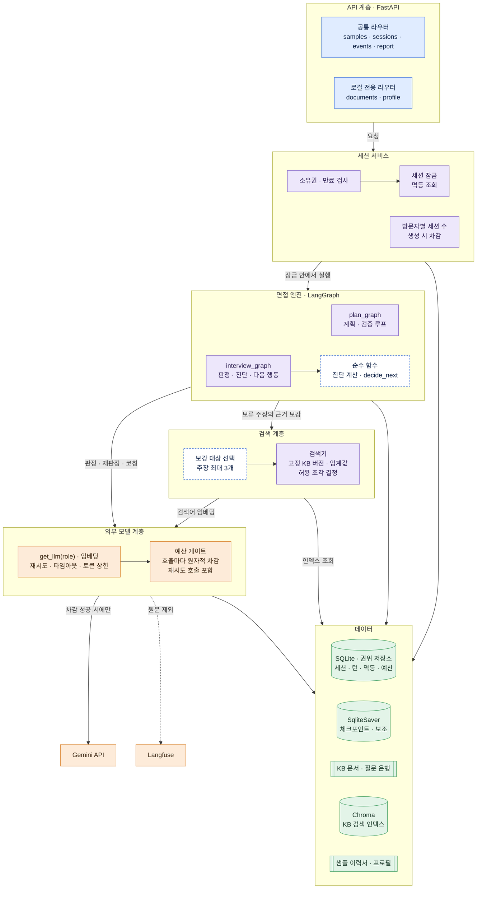
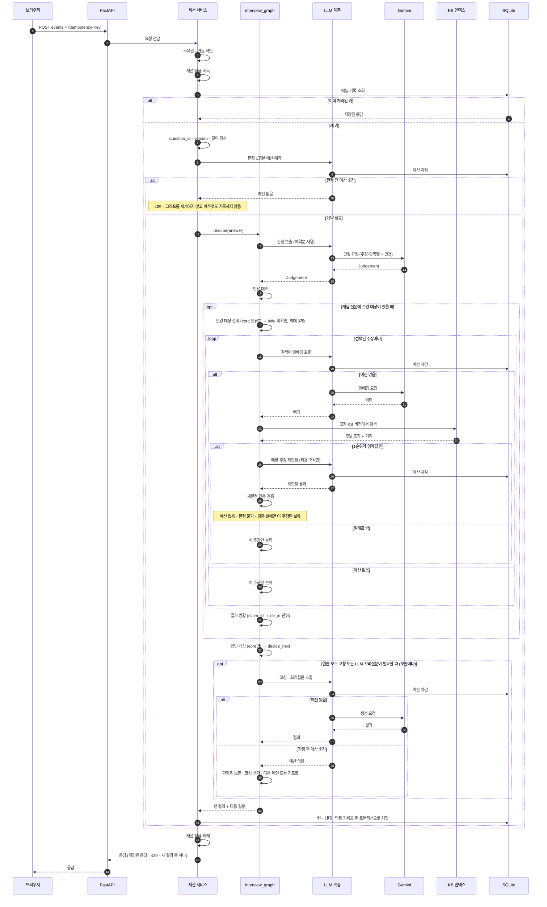
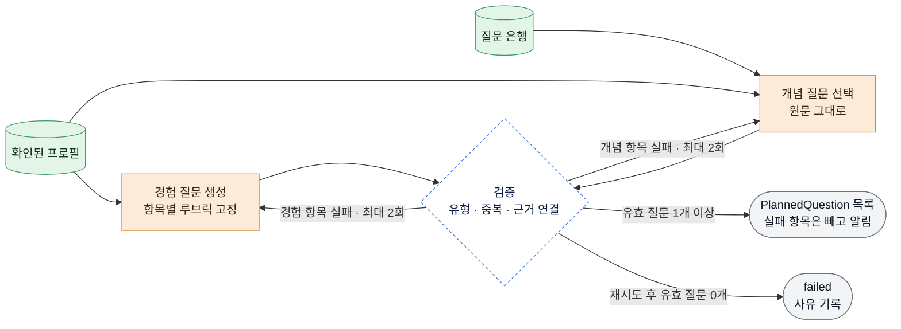
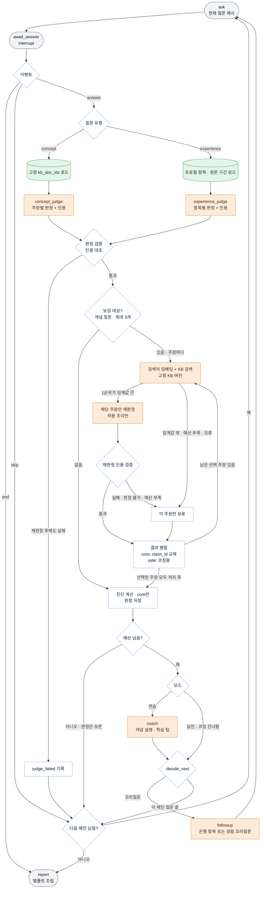

# AI 면접 코치 v2 설계 문서

- 작성일: 2026-11-20
- 브랜치: `redesign`
- 상태: 초안 r8. Codex 교차 검토 6회 반영, 개인 프로젝트로 범위 조정, 근거 보강 검색(RAG)을 MVP 기본 경로로 (코드 변경 없음)
- 선행 문서: [project_spec_v1.md](project_spec_v1.md), [experiment_log.md](experiment_log.md)

---

## 0. 요약

| 항목 | v1 (현재) | v2 (이 문서) |
|---|---|---|
| 타깃 | 국내 백엔드 신입 | **국내 LLM 애플리케이션 엔지니어 신입** |
| 면접 단위 | 질문 1개를 골라 최대 3턴 파고드는 드릴 | **메인 질문 N개(경험·개념 혼합) × 꼬리질문 상한**. MVP는 메인 3개 × 꼬리 1개 |
| 채점 근거 | 모든 질문을 고정 KB로 채점 | **질문마다 채점 근거를 고정**: 개념 질문은 검수된 KB 문서 ID, 경험 질문은 확인된 이력서 프로필과 질문별 루브릭 항목 |
| 채점 방식 | 0-10점 하나, 4점/7점 경계로 분기 | **주장·항목 단위 판정**(인용 포함) → 규칙으로 진단 범주 계산 → 범주로 분기. 점수는 표시용 |
| 피드백 시점 | 매 턴 즉시 | **연습 모드**(턴마다 즉시, MVP) / **실전 모드**(끝나고 리포트, MVP 바로 다음) |
| 낮은 점수일 때 | 세션 종료 | 개념 설명 후 **다음 메인 질문으로 진행** |
| 흐름 제어 | 그래프 + API 계층 우회 로직 | **실패·넘기기·종료·중복 제출까지 포함한 전이표**를 순수 함수로 |
| RAG (검색) | 질문 문장으로 벡터 검색 → 상위 3개로 채점 | **근거가 확정된 곳은 ID로 고정, 고정 근거로 확인 못한 답변 속 주장에만 KB 검색.** 해당 주장만 재판정하고, 핵심 주장은 진단에·질문 밖 주장은 코칭에 반영(MVP 기본 경로, 효과는 측정 후 유지 여부 결정). 검색 방식(벡터 / BM25 / 하이브리드 / reranking)은 첫 공개 이후 비교 실험 |
| Agent·도구 | 고정 파이프라인 (검색 1회 → 채점) | 결정적 그래프가 기본. **Judge 근거 방식 3가지(고정만 / 규칙 기반 추가 검색 / 도구형)를 비교 실험.** 규칙 기반 추가 검색이 MVP 기본 |
| 프로젝트 성격 | 서비스형 데모 | **개인 프로젝트.** 공개 서버(HTTPS)는 첫 공개 때 샘플 이력서만, 다음 단계(M2b)에서 프로젝트 설명 붙여넣기 추가. 제작자는 **로컬에서** 자기 이력서로 연습. 실서비스는 범위 밖(§2.5) |
| 사용자·데이터 | 구분 없음 (이력서 컬렉션 전역 공유) | `owner_id` 격리와 삭제 범위를 M0에서. 공개 서버에는 업로드 API 자체가 없음. 서버 공용 LLM 예산으로 비용 차단 |
| 평가 체계 | 검색·채점 경로만 측정 (일부 지표 해석 오류) | 검색 / 채점 / 생성 / 도구 / 사용성을 컴포넌트별로. **개발용과 홀드아웃 분리**, 버전 기록, 사람 표본 판정 |
| 스택 | LangGraph · Gemini · Chroma · FastAPI · 순수 JS | 백엔드 유지, LLM 프로바이더 추상화. **MVP는 기존 UI를 고쳐서 사용**, 프론트 교체는 후속 |
| 외부 연동 | 없음 | **Markdown 내보내기 먼저**. 노션(REST)은 수요 확인 후. MCP 공개는 보류 |
| 일정 | - | **1인, 1-2개월**에 맞춘 단계(§11) |

---

## 1. 왜 다시 설계하는가 (v1 진단)

### 1.1 v1 구조 요약

- **Chain A (질문 생성)**: 검색어(기본값 있음)로 업로드 문서(`user_docs`)를 검색해 최대 3개 chunk를 가져오고, Gemini가 질문 5개를 만든다.
- **Chain B (채점과 Agent)**: 질문 문장으로 고정 KB(29개 문서, Gemini Embedding)를 검색한다. 1순위 거리가 0.311 이상이면 `out_of_scope`로 채점을 보류한다. 그렇지 않으면 Judge가 감점·점수·레벨을 낸다. 점수가 0-3이면 개념 설명, 4-6이면 Learning Tip → 꼬리질문, 7-10이면 심화 질문으로 간다.
- **멀티턴**: `interrupt` / `Command(resume)` 사이클, 최대 3턴. 0-3점이나 범위 밖이면 루프에서 빠진다.
- **평가**: Retrieval 평가셋 65문항(검색 지표는 범위 밖 문항을 제외하고 실행), Judge Calibration 44개(경로 일치 90.9%, 반복 측정 시 경로 정확도 폭 약 5%p), 범위 밖 임계값 group 5-fold.

### 1.2 핵심 결함

코드 근거는 Codex 교차 검토(§1.4)에서 `파일:줄` 단위로 확인했다.

**기획**
1. **질문을 만드는 근거와 채점하는 근거가 다르다.** 질문은 업로드 문서에서, 채점은 고정 KB에서 한다. 경험 질문은 구조상 정답 근거가 없어 보류되거나 엉뚱한 근거로 채점될 수 있다. 범위 밖 안내("관련 문서를 업로드하세요")를 따라도 채점 근거는 바뀌지 않는다.
2. **"면접"이 정의되지 않았다.** 목록에서 하나를 골라 이어지는 드릴이고, 0-3점이면 개념 설명 후 세션이 끝난다.
3. **면접관 역할과 코치 역할이 섞여 있다.** 한 턴 응답이 평가·코칭·다음 질문을 함께 준다. 드릴이라면 자연스럽지만 실전 연습과는 다르다. 어떤 경험을 약속하는지 정해지지 않았다.
4. **분기가 경계 근처에서 불안정하다.** 분기는 `technical_score`만 쓰고, 경계(4, 7) 부근 케이스가 반복 실행마다 다른 경로로 갔다(spec 기록). 반복 측정에서 전체 경로 정확도가 약 5%p 폭으로 흔들렸다. `completeness_score`와 `level`은 분기에는 쓰이지 않고 화면 표시(배지, 요약 평균)에만 쓰인다. `senior`는 페르소나상 거의 나오지 않는다.
5. **세션 간 기억이 없다.** 세션마다 새 UUID를 쓰고, 메모리 체크포인터에 현재 세션만 남는다.
6. **질문 생성 제어가 약하다.** 프롬프트가 짧고, 스키마는 문자열 목록만 검사하며, 유형·난이도·중복 제어가 없다.

**구조와 코드**
7. `user_docs`가 **사용자 구분 없는 단일 컬렉션**이고 검색에 소유자 필터가 없다. 교차 사용자 노출이 가능한 구조다. 업로드 파일명이 그대로 경로와 `source` 키로 쓰여서 같은 이름이면 서로 덮어쓴다.
8. 로컬 임베딩을 "이력서를 외부로 보내지 않기 위해" 쓴다고 했지만, 질문 생성 단계에서 **검색된 이력서 원문 조각**이 Gemini 프롬프트로 들어간다. 로컬 임베딩은 임베딩 단계의 전송만 막는다. (모델 파일 423MB, 이미지 크기는 기록상 3.79GB이고 amd64 기준 2.7GB)
9. 평평한 `InterviewState`에 이전 분기의 키가 남는다. 현재는 API가 `next_action`에 맞는 키만 골라 반환하는 방식(`COACHING_KEYS_BY_ACTION`)으로 막아 둔 상태다.
10. 범위 밖 재개는 그래프가 `END`에 도달한 뒤 API가 같은 thread에 새 입력을 넣는 우회 방식이다. spec의 "범위 밖 반복 상한 / 질문 소진 시 종료"는 구현되지 않았다. 서버 `history`와 프론트 `sessionTurns`가 따로 있고 담는 내용도 다르다.
11. 빌더 5종의 배선이 중복된다. 단발성 API는 요청마다 그래프를 빌드한다(멀티턴 그래프는 프로세스 단위로 재사용). 노드마다 LLM 객체를 만들고, 서버에 실패 복구 경로와 스트리밍이 없다. `chains.py`는 서비스 경로에는 없고 레거시 스크립트 `scripts/run_calibration.py`만 쓴다.
12. **서버에 완전한 세션 기록이 없다.** `history`는 `await_answer`가 재개될 때만 추가되므로 마지막 턴이 빠진다(테스트도 `MAX_TURNS - 1`개를 기대). 범위 밖으로 끝난 턴도 기록되지 않는다. 화면의 "면접 종료"는 서버에 아무것도 보내지 않는다. `session_id`만 알면 누구나 그 세션에 접근할 수 있다(소유자 검증 없음).
13. **업로드가 원자적이지 않다.** 파일을 먼저 쓰고, 파싱한 뒤, 기존 chunk를 지우고 새 chunk를 넣는다. 중간에 실패하면 파일과 인덱스가 서로 다른 버전을 가리킬 수 있다. 파일 크기 상한도 없다.

**평가**
14. **RAGAS Faithfulness 0.4412는 시스템이 아닌 지원자 답변을 측정한 값이다.** `scripts/run_ragas.py`는 `answer`에 캘리브레이션 세트의 지원자 답변을 넣는다. 실험 로그는 대상을 정확히 적었지만, README가 이 값을 "LLM이 컨텍스트 밖 내용을 덧붙인다"의 근거로 쓴 것은 이 실험으로 뒷받침되지 않는다.
15. **생성물 품질 지표가 없다.** 질문, 개념 설명, 학습 팁, 꼬리질문을 체계적으로 측정하지 않는다. Retrieval 평가의 Faithfulness는 `answer`에 사람이 쓴 reference를 넣으므로 "검색된 근거가 기준 답변을 얼마나 뒷받침하는가"에 가깝다. 평가 LLM도 생성 모델과 같다.
16. **Context Precision의 입력 형식 때문에 순위를 평가하지 못한다.** 상위 chunk를 하나의 문자열로 합쳐 컨텍스트 한 항목으로 넘기므로, 관련 chunk가 앞 순위에 오는지를 구분할 수 없다.

### 1.3 v1에서 가져갈 자산

- 측정 우선 문화: 실험 로그, 평가셋 설계 원칙(group k-fold, `key_evidence` 전수 검사, 포화 진단), 호출량 예산 헬퍼(`eval_budget.py`)
- "근거 없으면 채점하지 않는다"는 정책
- 라우팅을 순수 함수로 분리해 LLM 없이 전수 검증하는 테스트 구조
- 감점 근거를 보여주는 UX, 요약 모달의 턴별 흐름
- Docker / CI / CD 파이프라인

### 1.4 교차 검토 기록 (Codex, 2026-11-20)

초안 r1을 Codex가 코드와 대조해 독립 검토했다. 결과와 처리는 다음과 같다.

- **사실 검증:** §1.2의 13개 항목 중 9개 맞음, 4개 부분적으로 맞음. 부분적으로 맞은 항목은 위 본문에서 정정했다(5%p의 의미, completeness·level의 실제 사용처, 단발성 그래프만 요청마다 빌드, `chains.py` 사용처). 놓친 결함 3개(12, 13, 16)를 추가했다.
- **수용:** 개인정보 처리 조건 선행(§2.5), 실패·사용자 행동을 포함한 전이표(§5.4), 주장 단위 판정(§5.2), 질문별 루브릭 항목 고정(§6.2), Judge 근거 방식 비교 실험(§7.6), 계획 에이전트 도구 축소(§7.6), 리포트 생성 책임 분리(§5.5), 평가 홀드아웃·버전·사람 표본(§9), MVP 축소(§11), 비활성 채용공고 입력란 제거.
- **사용자 결정:** 첫 공개는 본인·합성 이력서만 받는다. MVP는 축소안으로 가고 실전 모드를 바로 다음 단계로 둔다. 1인 1-2개월 기준이다.

**2차 검토 (r2 → r3)**
- 방향과 MVP 범위는 타당하다는 판단. 1차 지적의 정정 사항이 반영됐음을 확인했다.
- **사용자 결정 (r3 → r4):** 이 프로젝트는 개인 프로젝트로 두고, 모르는 사람에게 실서비스로 여는 것은 계획하지 않는다. 실사용자 공개 조건은 "범위 밖: 실서비스로 연다면 필요한 조건"으로 옮겼고, 그 조건에만 필요한 작업(동의 화면, 전송 전 식별 정보 제거)은 로드맵에서 뺐다. 소유권 검증, 재시도 계약, 삭제 범위는 데모 방문자들이 한 서버를 같이 쓰므로 유지한다. 데모 비용 때문에 체험 횟수 제한을 추가했다.
- **3차 검토 (r4 → r5):** "다음을 고친 뒤 커밋" 판단. 수용: 공개 데모도 HTTPS 필요(r4에서 범위 밖으로 잘못 옮겼던 것을 되돌림), 데모 방문자 자유 입력의 경계(전송 안내, 서버 길이 상한, 프로필·계획 읽기 전용), 서버 공용 예산의 원자적 차감과 세션 생성 멱등성, 참조 문서 권한 검사와 세션 만료·삭제 계약, 멱등 조회를 잠금 안으로, 문서 내부 불일치 정리. 사용자 결정: 제작자 업로드는 로컬 전용, 데모 답변은 자유 입력.
- **사용자 결정 (r5 → r6):** 포트폴리오에서 RAG 경험이 결과물로 드러나도록, 근거가 불확실한 주장에 대한 KB 검색(기존 E1의 방식 ②)을 MVP 기본 경로로 올렸다. 억지로 넣은 검색이 아니라, 지원자가 질문 은행에 고정된 문서 밖의 개념을 말하는 실제 상황을 다룬다. 검색 방식 비교(벡터 / BM25 / 하이브리드 / reranking)를 실험에 추가했다.
- **6차 확인 (r7 → r8):** "커밋 가능" 판단, Mermaid 6개 파싱 통과. 남은 정리 세 가지를 반영했다: 인용 검증의 항목 일치 규칙을 `core`·경험 루브릭에만 적용하고 보강 재판정은 선택 ID와 인용 구간 유지, ①↔② 비교를 M2 공개 판단에 포함하고 코칭 조건까지 맞춤(③은 공개 이후), 면접 그래프에 주장별 반복 후 병합 표시.
- **5차 검토 (r6 → r7):** "다음을 고친 뒤 커밋" 판단. Mermaid 6개는 파싱 통과. 수용: 검색 대상과 판정 스키마 정합(핵심 판정 `core`와 질문 밖 주장 `side` 분리, `missing` 제외, 병합 후 진단 1회), 검색 권한과 인용 권한 구분, 검색·재판정 실패 시 그 주장만 보류(`judge_failed`와 구분), 임베딩 호출의 예산 차감과 안내 문구, 효과 미측정 명시와 두 가지 보고 분리, 조각 단위 라벨과 1순위 근거 충분성 지표, ①↔② 같은 최초 판정 비교와 기본값 되돌림 플래그, RRF 점수를 근거 충분성에 쓰지 않음, 첫 공개는 벡터 하나로 고정, 그림에 검색 → 재판정 → 인용 검증 → 병합 경로 표시.
- **4차 확인 (r5):** "커밋 가능" 판단. M0 구현 계약으로 남긴 세 가지(턴 도중 예산 소진, 세션 생성 키의 범위, 410과 404 구분)를 바로 반영했다.
- **수용 (2차):** 데모 공개 정책을 API에서 강제(§2.5, §8), 판정 규칙의 빈칸(분모, 유효 항목 0개, 상태별 인용 필수 여부, §5.2), 응답 유실·재시작을 포함한 재시도 계약과 권위 저장소(§5.4, §7.3, §8), 개념 질문 원문 고정과 꼬리질문의 은행화(§3), 다음 행동의 독립 라벨링과 E1 추가 검색 범위(§6.4, §7.6), 최소 v2 Judge를 M1 산출물로(§11), 일정 추정과 실전 모드 축소판(§11).

---

## 2. 제품 정의

### 2.1 타깃 사용자

**LLM 애플리케이션 엔지니어 직군을 준비하는 국내 신입.** RAG, 에이전트, 프롬프트, LLM 평가, 서빙 경험을 사이드 프로젝트나 부트캠프 수준에서 쌓은 사람이다.

- ML 리서치·모델 학습 직군은 제외한다.
- 1-3년차 경력자는 후속 확장으로 둔다.

**이 직군을 고른 이유**
- 제작자가 도메인을 직접 검증할 수 있다. KB 작성과 채점 판정의 정확도가 올라간다.
- 제작자 본인의 이력서가 첫 번째 테스트 케이스가 된다.
- 단점: 지식이 빨리 낡는다. KB 문서에 검토일을 기록하는 운영 규칙을 둔다(§6.1).

### 2.2 사용자가 겪는 문제

1. **자기 프로젝트를 설명하지 못한다.** 왜 그 chunk 크기였는지, 왜 그 임베딩이었는지, 어떻게 평가했는지를 물으면 막힌다.
2. **개념을 어디까지 알아야 하는지 모른다.**
3. **피드백을 줄 사람이 없다.**
4. **실전 감각이 없다.** 꼬리질문이 이어지는 압박 속에서 답해본 적이 없다.

### 2.3 해결하는 것과 하지 않는 것

**해결한다**
- 1: 이력서 기반 **경험 질문**과 꼬리질문, 질문별 루브릭 채점
- 2: KB 기반 **개념 질문**, 주장 단위 정확성 판정, 개념 설명
- 3: 진단과 근거(인용), 개선점
- 4: **실전 모드** (MVP 바로 다음 단계)

**하지 않는다**
- 음성 면접, 말하기 훈련
- 이력서 첨삭, 자소서
- 코딩 테스트
- **경험의 진위 검증.** 이력서는 경험이 사실임을 입증하는 자료가 아니다. 이력서와 직접 모순되는지만 본다
- 채용공고 매칭 (확장 단계. MVP 화면에 자리도 두지 않는다)
- MCP 서버 공개 (§7.9에서 검토 후 보류)

### 2.4 성공 기준

| 구분 | 기준 |
|---|---|
| 제품 | 사용자 한 명이 이력서 하나로 면접 한 세션(메인 3개)을 끝내고, 나갔다 돌아와도 같은 세션과 리포트를 다시 열 수 있다. 모든 판정에 인용된 근거(KB 문서 또는 이력서 구간)가 붙는다 |
| 품질 | 홀드아웃에서 판정 일치율·행동 일치율은 **최소치 이상**, 답변별 행동 변경률·경계 사례 오분기는 **최대치 이하**. 수치는 M1 기준선 측정 후 정한다 |
| 비용·지연 | 세션당 LLM 호출 수·비용, 턴 응답 p95, 실패율의 최대치를 M1에서 정하고 지킨다. 리포트 p95 최대치는 M3b 완료 기준이다 |
| 운영 | 다른 `owner_id`의 리소스에 접근할 수 없다. 삭제 요청 시 §2.5 표의 모든 위치에서 지워진다 |
| 포트폴리오 | 설계 결정마다 "왜"와 측정 근거, 실패 사례가 문서에 남는다 |

### 2.5 프로젝트 성격과 데이터 정책

**이 프로젝트는 개인 프로젝트다.** 모르는 사람에게 실서비스로 여는 것은 계획하지 않는다. 사용자는 두 부류다.

| 사용자 | 어디서 | 이력서 | 입력 |
|---|---|---|---|
| 데모 방문자 (포트폴리오를 보는 사람) | 공개 서버 (`DEMO_MODE`, HTTPS) | 첫 공개: 서버가 제공하는 샘플만. **M2b부터 프로젝트 설명 붙여넣기 추가** | 답변 자유 입력. 프로필·계획은 읽기 전용 |
| 제작자 본인 | **로컬 실행** (`LOCAL_MODE`) | 자기 이력서 업로드 | 전부 (프로필 수정, 계획 편집 포함) |

**v1과의 차이:** v1 공개 서버는 이력서 파일 업로드를 받았다. 하지만 HTTP 평문 전송, 서버에 남는 파일, 사용자 간 이력서가 섞이는 전역 컬렉션 때문에 경고문만으로는 막을 수 없는 위험이 있었다. v2는 첫 공개에서 업로드를 막고, 다음 단계(M2b)에서 위험을 줄인 형태(프로젝트 설명 붙여넣기)로 "내 경험으로 면접 보기"를 되살린다.

**배포 경계는 화면이 아니라 서버 구성으로 강제한다.**
- 공개 서버에는 업로드·프로필 수정 라우터를 **등록하지 않는다.** 초대 토큰 같은 원격 업로드 경로를 두지 않으므로 그 설계도 필요 없다.
- 공개 서버는 **HTTPS로만** 서비스한다. 방문자 답변과 세션 쿠키가 오가기 때문이다. 도메인을 사지 않는다면 무료 서브도메인(예: DuckDNS)으로 Let's Encrypt 인증서를 받는다.
- 샘플은 합성 이력서와 **제작자 이력서의 비식별 사본**(이름, 연락처, 학교·회사명, 개인 링크 제거)이다. 원본 이력서는 공개 서버에 두지 않는다.
- 제작자의 이력서는 로컬에서 LLM 프로바이더(Gemini)로 전송된다. 본인 데이터에 대한 본인의 선택이며, 사용하는 API 등급의 데이터 사용 조건을 확인한다.

**데모 방문자의 자유 입력**
- 답변란 옆에 "답변은 채점과 근거 검색을 위해 Gemini로 전송됩니다(일부 문장은 검색용 임베딩에도 쓰입니다). 이름·연락처 등 개인정보를 쓰지 마세요."를 표시한다.
- 답변 길이 상한을 **서버에서** 적용한다(초과 시 400). 입력 검사의 주입 패턴 플래그(§7.8)와는 별개다.
- 시작 전 질문 교체는 서버가 제시한 대체 질문 중에서 고르는 것만 받는다. 자유 텍스트로 질문을 바꿀 수 없다.

**프로젝트 설명 붙여넣기 (M2b, 첫 공개 다음 단계)**

이력서 파일 대신 "프로젝트 경험을 붙여넣으세요" 입력란을 공개 서버에 연다. 경험 질문에 필요한 건 프로젝트 내용이지 이름·연락처가 아니라는 판단이다.

| 장치 | 내용 |
|---|---|
| 입력 형태 | 텍스트만 (파일 업로드 없음, 파싱 없음). 길이 상한 4,000자 |
| 식별 정보 차단 | 서버가 전화번호, 이메일, 주소, 주민번호 형식, 개인 URL 패턴을 감지하면 **거부**하고 지울 부분을 알려준다 |
| 저장 | 원문은 저장하지 않는다. 메모리에서 프로필을 추출한 뒤 **프로필만** 세션에 저장한다 |
| 보관 | 프로필은 세션과 함께 생성 시점부터 7일 뒤 삭제 (§2.5 데이터 표와 같은 규칙) |
| 고지·동의 | 입력란 위에 수집 항목(프로젝트 설명), 목적(면접 질문 생성·채점), 보관 기간(7일), 국외 전송(Gemini, 해외)을 표시하고 체크박스 동의를 받는다 |
| API 등급 | 방문자 입력이 프로필 추출에 쓰이므로, 이 단계부터 입력 데이터가 학습에 쓰이지 않는 등급을 쓴다 |
| 비용 | 프로필 추출 1회가 공용 예산에서 차감된다. 세션 수 제한은 그대로 |

- 패턴 검사는 완전하지 않다. 그래서 입력란 안내와 동의, 원문 비저장, 짧은 보관을 함께 둔다.
- 실서비스 수준의 이력서 파일 업로드는 여전히 범위 밖이다(아래 목록).

**비용 차단 (데모)**
- **주 차단: 서버 공용 LLM 예산.** 모든 외부 모델 호출(생성과 임베딩) 직전에 SQLite에서 하루 예산을 원자적으로 차감한다. 모델 재시도와 커밋 전 재처리로 생기는 호출도 포함한다. 호출마다 입력·출력 토큰 상한을 둔다. 하루 경계는 한국 시간 자정이고, 카운터는 SQLite에 있으므로 재시작해도 유지된다. 초기값은 보수적으로 하루 300회이며 M1 측정 후 조정한다.
- **보조: 방문자별 세션 수.** 같은 `owner_id` 하루 3세션, 같은 IP 하루 10세션(공용 네트워크 고려). 둘 중 하나라도 넘으면 새 세션을 만들지 않는다. 세션은 **생성 시점**에 차감한다.
- 예산이 소진되면 새 세션과 새 판정은 "오늘 체험 한도에 도달했습니다" 안내로 응답한다. **LLM이 필요 없는 행동**(조회, `skip`, `end`, 템플릿 리포트, 삭제)은 한도와 무관하게 허용한다.
- **턴 도중 소진:** 판정은 성공했는데 코칭이나 꼬리질문 생성 직전에 한도에 걸리면, 이미 얻은 판정은 저장하고 커밋한다. 코칭은 생략하고, 꼬리질문 대신 다음 메인으로 진행한다(다음 메인이 없으면 리포트로). 응답에 "한도로 일부 생략"을 표시한다. 턴 전체를 실패로 되돌리지 않으므로 재시도가 같은 판정을 다시 호출하지 않는다.

**데이터 위치와 삭제 범위**

| 데이터 | 저장 위치 | 만료 | 삭제 시 |
|---|---|---|---|
| 샘플 이력서와 미리 만든 프로필 | 서버 번들 | - | 해당 없음 (식별 정보 없음) |
| 업로드 이력서 원본, 추출 텍스트, 프로필 (로컬만) | 로컬 업로드 디렉터리 (uuid 파일명), DB | 없음 (제작자가 직접 삭제) | 문서와 그 문서로 만든 세션 전체 연쇄 삭제 |
| 세션·턴 기록 (답변, 판정, 인용) | DB, 체크포인트 | 데모 세션은 **생성 시점부터 7일** | 세션 단위 연쇄 삭제 |
| 리포트·코칭 | DB | 세션과 동일 | 세션과 함께 삭제 |
| 멱등 기록 (저장된 응답 포함) | DB | 세션과 동일 | 세션과 함께 삭제 |
| 사용량 카운터 | DB | 하루 단위로 초기화, 30일 후 삭제 | 해당 없음 (원문 없음) |
| 추적 기록 | 추적 도구 | 30일 | 원문을 남기지 않으므로 해당 없음 |
| 평가셋 | 레포 | - | 합성·본인 데이터만. 데모 방문자의 답변은 넣지 않는다 |

- **만료 계약:** 만료 시각이 지났지만 정리 전이면 조회·재개 요청에 410(만료), 정리 작업이 행을 지운 뒤에는 404로 응답한다. 별도의 만료 기록은 두지 않는다. 정리 작업이 주기적으로 돌며 세션, 턴, 체크포인트, 리포트·코칭, 멱등 기록을 함께 지운다.
- **수동 삭제:** 방문자도 `DELETE /sessions/{id}`로 만료 전에 자기 세션을 지울 수 있다.
- **로그:** 추적과 애플리케이션 로그에는 시간, 토큰, 오류, 근거 ID, 진단 범주만 남긴다. 이력서·답변 원문과 저장된 API 응답 본문은 남기지 않는다. 원문이 남지 않는지 테스트한다.

**범위 밖: 실서비스로 연다면 필요한 조건**

이번 범위에서는 하지 않지만, 판단 근거로 남긴다.

1. 공개 서버의 이력서 **파일** 업로드 경로 (파싱 자원 상한, 원격 업로드 보호 포함). HTTPS는 데모에서, 텍스트 입력의 동의·비저장·패턴 검사는 M2b에서 이미 갖춘다
2. 데이터 사용 조건이 맞는 LLM API 등급 (무료 티어는 입력이 서비스 개선에 쓰일 수 있음)
3. 모든 리소스, 체크포인트, 도구 호출의 소유권 검증 (M0에서 이미 구현)
4. 업로드 문서에도 만료를 적용하고 테스트로 검증 (M0의 삭제 범위를 확장)
5. 업로드 화면에서 외부 LLM 전송 고지와 동의
6. **LLM 전송 전 식별 정보 제거:** 업로드 → 텍스트 추출 → 규칙 기반으로 이름 줄, 전화번호, 이메일, 주소, 개인 URL·SNS 계정 제거 → 프로필 추출. 프로필 스키마에도 식별 정보 필드를 두지 않는다
7. 남용 방지 강화: 계정 단위 사용량 제한, 일일 비용 상한과 알림

---

## 3. 핵심 개념: 질문 유형과 채점 근거

**질문을 만들 때 그 질문을 무엇으로 채점할지 함께 고정한다.**

| | 개념 질문 (`concept`) | 경험 질문 (`experience`) |
|---|---|---|
| 예시 | "RAG에서 chunk 크기를 키우면 무엇이 좋아지고 무엇이 나빠지나요?" | "임베딩 모델을 교체하셨던데, 무엇을 근거로 결정했나요?" |
| 출처 | **검수된 질문 은행** (토픽별 질문 + 핵심 주장 + `kb_doc_ids`) | 사용자가 확인한 이력서 프로필의 항목 |
| 채점 근거 | 고정된 `kb_doc_ids`의 문서를 직접 가져온다. 판정에서 근거 부족 주장이 나오면 **그 주장으로 KB 전체를 검색**해 보강한다(§3.4) | 질문별로 고정한 루브릭 항목 + 해당 프로필 항목의 원문 구간 (검색 없음) |
| 판정 단위 | 핵심 주장별 `충족 / 누락 / 오류 / 근거 부족` | 루브릭 항목별 `관찰됨 / 답변에 없음 / 해당 없음` |
| 범위 밖 | 메인 질문은 질문 은행에서 오므로 범위 안이 보장된다 | 해당 없음 (정확성을 판정하지 않는다) |

### 3.1 개념 질문 은행

생성 질문은 유효한 KB 토픽을 골라도 질문의 모든 전제를 KB가 뒷받침한다는 보장이 없다. 그래서 개념 메인 질문은 **사람이 검수한 질문 은행**에서 고른다.

```yaml
- id: chunking_tradeoff_01
  topic: chunking_strategy
  question: "RAG에서 chunk 크기를 키우면 무엇이 좋아지고 무엇이 나빠지나요?"
  key_claims:                     # 채점 체크리스트. 주장별로 충족 여부를 판정
    - "chunk가 크면 한 chunk에 문맥이 더 담긴다"
    - "chunk가 크면 관련 없는 내용이 섞여 검색 정밀도가 떨어진다"
    - "chunk가 크면 프롬프트 토큰이 늘어 비용·지연이 커진다"
  kb_doc_ids: [chunking_strategy]
  difficulty: basic
```

- 계획 단계의 LLM은 질문 은행에서 이력서와 관련 높은 질문을 **고르기만 한다.** MVP에서는 **질문 원문을 그대로 출제한다.** 표현을 바꾸면 묻는 범위가 바뀌어 `key_claims`와 어긋날 수 있기 때문이다.
- 이 구조 덕분에 개념 채점이 "KB와 대략 비교"가 아니라 **"이 주장들이 답변에 있는가"**가 된다.

**꼬리질문도 은행에 넣는다.** 메인 질문 항목마다 다음을 함께 검수한다.

```yaml
  claim_followups:              # 핵심 주장별 확인 질문. 그 주장 하나만 채점한다
    - claim: 1
      question: "chunk가 커지면 검색 정밀도에는 어떤 영향이 있을까요?"
  deeper: [chunking_overlap_01] # solid일 때 고를 수 있는 심화 항목 (별도 은행 항목, 자체 key_claims 보유)
```

- 은행 작업량이 늘어나지만, 개념 질문의 모든 출제 문장과 채점 기준이 검수된 상태가 된다. 토픽 8-12개 규모라 감당할 수 있다.

### 3.2 질문 객체

```text
PlannedQuestion
  id
  kind: "concept" | "experience"
  text
  intent                # 이 질문으로 확인하려는 것
  grounding:
    concept    → bank_id, key_claims, kb_doc_ids
    experience → profile_item_id, resume_spans, rubric_items (예: [decision_basis, alternatives])
  depth: 0 (메인) | 1.. (꼬리질문)
  parent_id
```

### 3.3 꼬리질문의 근거

| 꼬리질문 | 출처 | 채점 대상 |
|---|---|---|
| 개념, `missing`·`wrong` 주장 확인 | 은행의 `claim_followups` (검수된 원문) | 해당 주장 하나 |
| 개념, `solid` 심화 | 은행의 `deeper` 항목 | 그 항목의 `key_claims` |
| 경험, 빠진 루브릭 항목 | LLM 생성 (정확성 판정 없음) | `absent`였던 루브릭 항목 |
| 경험 → 개념 전환 | 프로필 항목의 기술과 토픽이 맞는 은행 메인 질문 | 그 항목의 `key_claims` |

- **맞는 은행 항목이 없으면 꼬리질문을 만들지 않고 다음 메인으로 간다.** 개념 문장을 즉석에서 생성하지 않으므로 MVP에서는 개념 꼬리질문이 근거 밖으로 나가는 경로 자체가 없다.
- 고정 근거로 확인하지 못한 답변 속 주장은 근거 보강 검색(§3.4)으로 확인을 시도한다. 그래도 확인하지 못하면 그 주장만 보류하고 점수에 반영하지 않는다(v1 정책의 주장 단위 버전).

### 3.4 근거 보강 검색 (RAG 경로)

**언제 검색하는가.** 고정 근거(`kb_doc_ids`)는 질문이 묻는 핵심 주장을 덮는다. 그래도 고정 문서로 확인할 수 없는 경우가 두 가지 있다.
- **핵심 주장의 보류분:** 핵심 주장에 대해 말했지만, 고정 문서에 없는 세부 내용이라 맞는지 판단할 수 없는 경우 (`insufficient_evidence`)
- **질문 밖 주장:** chunking 질문에 "HNSW 인덱스 때문에 ~"처럼 질문이 묻지 않은 개념을 꺼낸 경우

**판정 출력을 두 갈래로 나눈다** (스키마는 §5.2)

| | 핵심 판정 `core` | 주변 주장 `side` |
|---|---|---|
| 대상 | 질문 은행의 `claim_id` | Judge가 답변에서 찾은 질문 밖 주장 (`side_id`) |
| 상태 | `met / missing / wrong / insufficient_evidence` | `supported / contradicted / unverified` |
| 쓰임 | **진단과 다음 행동** | **코칭과 리포트에만.** 진단·다음 행동을 바꾸지 않는다 |

질문 밖 주장이 진단을 뒤집지 않게 하는 이유는, 질문이 요구하지 않은 내용으로 감점하지 않는다는 채점 원칙(§5.2) 때문이다.

**보강 대상 선택 (순수 함수)**
- 대상: `core`의 `insufficient_evidence`와 `side`의 `unverified`. **`missing`은 제외**한다. 인용할 답변 문장이 없기 때문이다.
- 검증된 답변 인용 하나당 주장 하나. 같은 인용을 가리키는 주장은 하나로 합친다.
- 우선순위는 `core`가 먼저, 그다음 `side`(Judge가 매긴 중요도 순)다. **턴당 최대 3개.**
- 개념 질문에만 적용한다. 경험 질문은 정확성을 판정하지 않으므로 검색하지 않는다.

**실행 순서 (선택된 주장마다)**

```text
1. 검색어 만들기: 검증된 답변 인용 문장 그대로 (MVP 기준선)
2. 임베딩 호출 (예산 게이트에서 차감)
3. 실행기가 고정 KB 버전의 인덱스에서 상위 k개 후보 검색
4. 1순위 거리가 임계값 안이면 → 그 조각 ID를 이 주장의 재판정에만 허용
   임계값 밖이면 → 보류
5. 해당 주장만 재판정 (예산 게이트에서 차감)
   core: met | wrong | 판정 불가    side: supported | contradicted | 판정 불가
6. 재판정 인용 검증: 답변 인용이 답변 원문에 있는가, KB 인용이 허용된 조각 안에 있는가
7. 병합: core는 같은 claim_id의 결과만 교체, side는 같은 side_id의 결과만 교체
```

진단 계산은 **병합이 끝난 뒤 한 번만** 한다. 분모는 검증된 `met / wrong / missing`이고, 전부 보류면 `unassessable`이다(§5.2).

**실패하면 그 주장만 보류한다.** 예산 부족(임베딩이든 재판정이든), 검색 오류, 임계값 밖, 재판정의 "판정 불가", 재판정 인용 검증 실패가 모두 해당한다. 보류된 주장은 `insufficient_evidence`나 `unverified`로 남고, 최초 판정의 나머지 결과는 그대로 보존한다. 이 경로에서는 `judge_failed`가 나오지 않는다. `judge_failed`는 **최초 판정**의 검증 재시도가 실패했을 때만 쓴다(§7.8).

**권한:** 모델은 검색어도 문서 ID도 고르지 않는다. 검색어는 실행기가 검증된 인용에서 만들고, 재판정에 쓸 수 있는 조각도 실행기가 정한다(§7.7). 거리 통과는 "관련 있는 후보"라는 신호일 뿐이다. 그 조각에 실제로 주장을 뒷받침하거나 반박할 문장이 있는지는 재판정이 "판정 불가"를 낼 수 있게 해서 따로 확인한다.

**재시작:** 커밋 전에 프로세스가 죽으면 턴 전체(최초 판정, 임베딩, 검색, 재판정)를 다시 실행하고, 외부 호출도 다시 차감한다. 커밋 후에는 저장된 응답만 재사용한다(§5.4).

**MVP 검색 방식:** Gemini Embedding 벡터 검색 + 거리 임계값. v1의 범위 밖 판정 경험(group k-fold 임계값 산출)을 이어받는다. 검색어가 "질문"이 아니라 "답변 속 주장 문장"이므로 **임계값은 새 평가셋으로 다시 정한다**(§9.1). BM25, 하이브리드, reranking은 첫 공개 이후 실험 E1b에서 비교한다(§7.6). v1에서 저빈도 전문용어("멱등성", "N+1")를 임베딩이 구분하지 못했던 경험이 BM25를 비교 대상에 넣는 근거다.

**효과는 아직 측정되지 않았다.** 질문 밖 주장이 실제 면접 답변에 얼마나 자주 나오는지, 확인했을 때 코칭이 의미 있게 바뀌는지는 추정이다. 그래서 두 가지를 **따로** 보고한다. 하나는 검색이 필요한 사례를 의도적으로 모은 평가셋의 성능(§9.1), 다른 하나는 자유 응답 파일럿에서 검색이 실제로 발동한 비율과 유용한 수정 비율(§9.5)이다. 기준을 넘지 못하면 공개 기본값을 고정 근거만 쓰는 방식으로 되돌린다(§7.6).

---

## 4. 사용자 흐름



1. **진입점**:
   - 공개 데모: 샘플 이력서 중에서 고른다. 프로필은 미리 만들어져 있고 읽기 전용이다.
   - 공개 데모 (M2b부터): 프로젝트 설명을 붙여넣는다. 식별 정보 패턴이 있으면 거부하고, 통과하면 프로필만 추출해 저장한다(§2.5).
   - 로컬: 자기 이력서를 올린다. PDF, MD, TXT를 받고 파일 크기·페이지 수·파싱 시간 상한을 둔다. 스캔 PDF는 여기서 걸러진다.
2. **프로필 추출과 확인 (로컬)**: 추출한 텍스트를 **한 번만** LLM에 보내 프로젝트, 역할, 기술, 성과를 구조화한다. 프로필 스키마에는 이름·연락처 같은 식별 정보 필드를 두지 않는다. 사용자가 프로필을 확인하고 고친다. 이후 단계는 원문 전체가 아니라 **확인된 프로필과 필요한 원문 구간**만 쓴다.
3. **계획**: 경험 질문은 프로필 항목에서, 개념 질문은 질문 은행에서 고른다. 기본 경험 2 : 개념 1이다. 시작 전 질문 교체는 로컬에서는 자유롭게, 공개 데모에서는 서버가 제시한 대체 질문 중에서만 가능하다.
4. **진행**: §5
5. **리포트**: 질문별 판정과 인용, 진단, 개선점, 다시 볼 KB 문서. Markdown 파일로 내보낼 수 있다.

---

## 5. 면접 흐름

### 5.1 세션 구조

| | MVP (첫 공개) | 이후 기본값 후보 |
|---|---|---|
| 메인 질문 | 3개 | 5개 |
| 메인당 꼬리질문 | 최대 1개 | 최대 2개 |
| 세션 최대 턴 | 6 | 15 |

- 낮은 진단이 나와도 세션은 끝나지 않고 다음 메인 질문으로 넘어간다.
- 사용자는 언제든 "넘기기"와 "종료"를 할 수 있고, 둘 다 서버에 기록된다. 종료해도 그때까지의 결과로 리포트가 만들어진다.

### 5.2 판정과 진단 범주

Judge는 **주장·항목 단위 판정과 인용**을 낸다. 진단 범주는 Judge가 직접 고르지 않고, **판정 결과에서 규칙(순수 함수)으로 계산**한다. 범주 경계에서 LLM이 흔들리는 대신, 흔들림이 개별 판정으로 쪼개져 어디서 갈렸는지 보인다.

**개념 질문**

판정 출력 (주장마다):
```text
core (질문 은행의 핵심 주장마다):
  claim_id, status: met | missing | wrong | insufficient_evidence,
  quote (답변 인용), evidence (KB 인용)
side (답변에서 찾은 질문 밖 주장, 최대 5개):
  side_id, quote (답변 인용, 필수), status: supported | contradicted | unverified,
  evidence (KB 인용. supported·contradicted일 때 필수), priority (보강 검색 우선순위)
```

진단 계산 규칙. **분모는 진단 가능한 주장**(`met`, `missing`, `wrong`)이다. `insufficient_evidence`는 분모에서 빼고 리포트에 "검증 불가"로 표시한다.

| 순서 | 조건 | 진단 | 의미 |
|---|---|---|---|
| 0 | 진단 가능한 주장이 0개 | `unassessable` | 판정 보류 |
| 1 | `wrong`이 하나라도 있다 | `misconception` | 그럴듯하지만 틀린 핵심 주장이 있다 |
| 2 | `missing`이 분모의 과반 | `missing` | 개념을 모르거나 핵심을 거의 다루지 못했다 |
| 3 | `missing`이 하나 이상 | `partial` | 방향은 맞지만 빠진 핵심이 있다 |
| 4 | 전부 `met` | `solid` | 핵심을 정확히 설명했다 |

**상태별 인용 필수 여부** (판정 검증 §7.8이 이 표를 따른다)

| 상태 | 답변 인용 `quote` | KB 인용 `evidence` |
|---|---|---|
| `met` | 필수 | 필수 |
| `wrong` | 필수 | 필수 (무엇과 어긋나는지) |
| `missing` | 없음 (말하지 않은 것이므로) | 필수 (빠진 내용의 근거) |
| `insufficient_evidence` | 필수 (판정할 수 없었던 문장) | 없음 |
- 진단은 `core`만으로 계산한다. 근거 보강 검색(§3.4)으로 `core`의 보류분이 확인되면 같은 `claim_id`의 결과만 교체된 뒤 진단을 계산한다.
- 질문 밖 주장(`side`)은 진단과 다음 행동을 바꾸지 않는다. `contradicted`는 개선점으로, `supported`는 강점으로, 끝까지 `unverified`면 "확인하지 못한 주장"으로 코칭과 리포트에 표시한다. 질문이 요구하지 않은 주변 내용으로 진단이 뒤집히는 것을 막는다.
- 이 규칙과 우선순위는 M1 라벨링 중 경계 사례를 보며 조정한다. 조정 이력은 실험 로그에 남긴다.

**경험 질문**

판정 출력 (질문에 고정된 루브릭 항목마다):
```text
rubric_item, status: observed | absent | not_applicable, quote (답변 인용)
contradiction: { answer_quote, resume_quote } | null   # 두 문장을 인용할 수 있는 직접 모순만
```

분모는 `observed`와 `absent`인 항목이다. `not_applicable`은 분모에서 뺀다.

| 조건 | 진단 |
|---|---|
| 분모가 0개 (전부 `not_applicable`) | `unassessable` |
| 분모의 항목이 전부 `absent` | `vague` |
| 일부만 `observed` | `shallow` |
| 전부 `observed` | `solid` |
| `contradiction`이 있다 | 위 진단 + `inconsistent` 플래그 |

인용: `observed`는 답변 인용 필수, `absent`와 `not_applicable`은 인용 없음. `contradiction`은 답변 인용과 이력서 인용이 둘 다 필수다.

- 이력서에 없는 내용을 답변에서 새로 말한 것은 모순이 아니다. 진위를 판정하지 않는다.
- 숫자 없는 정성적 성과, 팀 성과와 개인 역할이 갈리는 답, 짧지만 핵심 항목을 갖춘 답을 캘리브레이션 세트에 넣는다(§6.4).

**점수:** 화면 표시용으로만, 판정 결과에서 계산한다(예: 충족 주장 비율). 분기에는 쓰지 않는다.

### 5.3 다음 행동

| 진단 | 꼬리질문 여유 있음 | 상한 도달 |
|---|---|---|
| `unassessable` | 다음 메인 (연습 모드: "판정 보류" 안내) | 다음 메인 |
| `missing` | 다음 메인 (연습 모드: 개념 설명 먼저) | 다음 메인 |
| `misconception` | `wrong` 주장의 `claim_followups`. **메인 질문당 1회만** (`misconception_probed` 플래그) | 다음 메인 |
| `partial` | `missing` 주장의 `claim_followups` | 다음 메인 |
| `vague` / `shallow` | `absent` 루브릭 항목을 겨냥한 경험 꼬리질문 | 다음 메인 |
| `solid` | 개념: `deeper` 항목 / 경험: 경험 → 개념 전환 항목 | 다음 메인 |

**은행 항목을 쓰는 경로**(`claim_followups`, `deeper`, 경험 → 개념 전환)에서 해당하는 항목이 없으면 다음 메인으로 간다(§3.3). `vague` / `shallow`의 경험 꼬리질문은 LLM이 생성하므로 이 조건과 무관하다.

### 5.4 상태 전이표

`decide_next`는 아래 전체를 다루는 순수 함수이고, 이 표가 그대로 단위 테스트 케이스가 된다.

| 현재 상태 | 이벤트 | 다음 상태 | 기록 |
|---|---|---|---|
| (세션 생성) | `POST /sessions`, 새 생성 키 | `planning` | 세션 등록 + 방문자 세션 수 차감 (한 트랜잭션) |
| (세션 생성) | 이미 처리된 생성 키, 같은 본문 | 새로 만들지 않고 **기존 세션의 현재 상태 반환** | 없음 |
| (세션 생성) | 이미 처리된 생성 키, 다른 본문 | 422 | 없음 |
| `planning` | 계획 중 재시작 후, 같은 생성 키로 재전송 | **기존 세션에서 계획을 다시 실행** (세션 수는 다시 차감하지 않음, LLM 호출은 예산 차감) | 계획 |
| (모든 상태) | 만료 시각 경과, 정리 전 | 410 (만료) | 없음 |
| (정리 완료) | 행이 지워진 세션 요청 | 404 | 없음 |
| `judging` | 판정 성공 후 추가 생성 직전 예산 소진 | 다음 메인 또는 `reporting` | 턴 기록 (판정 저장, 코칭 생략 표시) |
| (모든 상태) | 공용 예산 소진 상태에서 LLM 호출이 필요한 이벤트 | 그대로 (429, 한도 안내) | 없음 |
| `planning` | 계획 성공 (질문 ≥ 1) | `awaiting_answer` (첫 메인) | 계획 |
| `planning` | 계획 결과 0개 | `failed` | 사유 (예: 프로필 항목 부족) |
| (모든 상태) | 이미 처리된 멱등 키, 같은 요청 본문 | 그대로. **저장된 이전 응답을 그대로 반환** (세션이 `done`이어도) | 없음 |
| (모든 상태) | 이미 처리된 멱등 키, 다른 요청 본문 | 그대로 (422) | 없음 |
| `awaiting_answer` | answer (현재 `question_id`, 현재 버전) | `judging` | 답변 |
| `awaiting_answer` | answer (다른 `question_id` 또는 이전 버전, 새 멱등 키) | 그대로 (409) | 없음 |
| `awaiting_answer` | skip | 다음 메인 또는 `reporting` | 턴 기록 (`skipped`) |
| `awaiting_answer` | end | `reporting` | 턴 기록 (`ended`) |
| `judging` | 판정 성공 | §5.3 표에 따라 | 턴 기록 (판정, 인용) |
| `judging` | 판정 실패 (재시도 1회 후) | 다음 메인 또는 `reporting` | 턴 기록 (`judge_failed`), 사용자에게 안내 |
| `judging` | 판정 성공, 진단 `unassessable` | 다음 메인 또는 `reporting` | 턴 기록 (판정 보류) |
| 마지막 메인 완료 | - | `reporting` | - |
| `reporting` | 리포트 조립 완료 | `done` | 리포트 |

- 세션 하나에는 동시에 한 요청만 진행된다(세션 단위 잠금).
- 모든 턴(넘기기, 종료, 실패 포함)이 서버 기록에 남는다. 프론트는 서버 기록만 그린다(v1 결함 10, 12 해소).
- `interrupt`로 재개하면 노드가 처음부터 다시 실행되므로, 외부 쓰기(DB 기록, 내보내기)는 재실행해도 결과가 같도록 턴 id 기준 upsert로 만들고 이를 테스트한다.

**재시도와 복구 계약**
- **권위 저장소는 SQLite 하나다.** 턴 기록, 세션 상태·버전·cursor, 멱등 기록(키, 요청 본문 해시, 저장된 응답)을 **한 트랜잭션**으로 커밋한다.
- LangGraph 체크포인트는 실행 위치를 위한 보조 저장소다. 체크포인트와 SQLite가 어긋나면(기록 도중 재시작 등) **SQLite를 기준으로 State를 다시 만들어** 그래프를 이어간다.
- 판정은 커밋 전에 끝나므로, 커밋 전에 죽으면 그 요청은 처리되지 않은 것으로 보고 같은 멱등 키로 다시 처리한다. 이때 다시 발생하는 LLM 호출도 공용 예산에서 차감된다. 커밋 후 응답이 유실되면 재전송에 저장된 응답을 돌려준다.
- **키는 두 종류다.** 세션 생성에는 생성 키(`POST /sessions`), 세션 진행에는 이벤트 키(`POST /sessions/{id}/events`). 둘 다 `Idempotency-Key` 헤더로 받는다.
- **생성 키는 `(owner_id, 생성 키)`에 유일 제약을 건다.** 같은 키로 동시에 두 요청이 오면 DB 유일 제약으로 하나만 세션을 만들고, 나머지는 기존 세션을 받는다.
- **재시작 시 복원:** SQLite에서 세션 상태·버전·cursor·턴 기록을 읽어 State를 만들고, 체크포인트가 이보다 앞서거나 뒤처지면 SQLite 기준으로 덮어쓴다. 처리 중이던 요청(커밋 전)은 복원하지 않는다.
- 단일 프로세스와 SQLite를 전제로 한다. 세션 잠금은 프로세스 내 잠금으로 충분하고 분산 잠금은 설계하지 않는다.
- **완료 기준에 포함하는 시나리오:** ① 커밋 후 응답 유실 → 같은 키 재전송, ② 판정 중 프로세스 재시작, ③ 커밋 직후 체크포인트 저장 전 재시작, ④ 같은 세션에 동시 요청 두 개, ⑤ 같은 키에 다른 본문, ⑥ 선행 요청 커밋 직후 같은 키 재전송(버전 충돌이 아니라 저장된 응답을 받아야 함), ⑦ 세션 생성 응답 유실 → 같은 생성 키 재전송(세션·사용량 중복 없음), ⑧ 같은 생성 키로 동시 요청 두 개, ⑨ 판정 성공 후 추가 생성 직전 예산 소진(판정 보존, 다음 메인 진행).

### 5.5 모드별 차이와 리포트

| | 연습 모드 (M2) | 실전 모드 축소판 (M3a) | 실전 모드 + 일괄 코칭 (M3b) |
|---|---|---|---|
| 턴마다 보여주는 것 | 진단, 판정과 인용, 코칭 | 다음 질문만 | 다음 질문만 |
| 턴마다 생성하는 것 | 판정 + 코칭 + 다음 질문 | 판정 + 다음 질문 | 판정 + 다음 질문 |
| 진행 중 조회 API | 전체 기록 | **현재 질문과 진행률만.** 판정·미래 질문은 응답에 넣지 않는다 | 같음 |
| 끝날 때 | 템플릿 리포트 | 템플릿 리포트 | 템플릿 리포트 + 생성형 코칭 |

**리포트 생성 책임**
- 기본 리포트는 **저장된 판정, 인용, 진단, 다시 볼 KB 문서를 고정 템플릿으로 조립**한다. LLM 호출이 없다. M2와 M3a는 이것만 한다.
- (M3b) 생성형 코칭(턴별 코칭, 세션 총평)은 **턴 id에 연결된 별도 레코드**로 저장한다. 턴 레코드는 바꾸지 않는다.
- (M3b) 종료 시 코칭 생성 작업을 한 번 등록하고, 동시 실행 수 상한을 둔다. 생성 호출도 공용 예산에서 차감된다. 리포트 조회 API는 상태(`pending / partial / done`)와 결과만 돌려주고 생성을 일으키지 않는다. 일부 실패하면 기본 리포트에 성공한 코칭만 붙여 보여주고, 실패한 턴은 재시도할 수 있다.
- 사용자가 마지막 답변 직후 나갔다 돌아오면 같은 세션의 리포트(진행 중이면 그 상태)를 본다.

---

## 6. 데이터 설계

### 6.1 Interview KB와 질문 은행

**MVP 범위: 핵심 토픽 8-12개.** 1인 1-2개월 기준이다. 토픽당 KB 문서 1개와 검수된 메인 질문 2-3개를 만든다.

1차 후보 (이력서와 겹칠 가능성이 높은 순):

| 영역 | 토픽 |
|---|---|
| 임베딩·검색 | 임베딩과 유사도(cosine vs L2), chunking 전략, 하이브리드 검색과 reranking |
| RAG | RAG 파이프라인과 실패 유형(검색 실패 vs 생성 이탈), 범위 밖 처리 |
| 프롬프트 | structured output, 프롬프트 인젝션 |
| 에이전트 | tool calling, 그래프 기반 오케스트레이션과 human-in-the-loop |
| 평가 | LLM-as-judge와 편향, RAG 평가 지표의 의미 |
| 서빙 | 지연·스트리밍·캐싱·비용 |

확장 후보: 토큰화·컨텍스트 윈도우, 샘플링, 환각, Transformer 개요, RAG vs 파인튜닝, LoRA, 메모리, MCP, 관측성, PII 처리.

**출처 정책**
- 직접 요약해 작성하는 것이 기본이다. 원문을 복제하지 않는다.
- 문서마다 출처(논문, 공식 문서, 오픈 라이선스 교재)를 단다.
- 공개 면접 질문 모음은 토픽 선정 참고용으로만 쓴다.

**문서 형식**

```yaml
---
topic: chunking_strategy
area: retrieval
difficulty: basic
sources: [ ... ]
last_reviewed: 2026-11-xx
---
```

- `last_reviewed`가 오래된 문서는 CI에서 경고한다.
- 질문 은행의 `key_claims` 각각이 KB 문서 안에 근거 문장을 갖는지 `key_evidence` 방식으로 전수 검사한다(API 불필요).
- 기존 백엔드 KB 29개는 `kb/legacy_backend/`로 옮겨 보존한다.

### 6.2 경험 루브릭

루브릭 항목 4개를 정의하고, **질문을 만들 때 그 질문이 볼 항목을 1-2개 고정한다.** 묻지 않은 것(예: 측정을 묻지 않았는데 측정 언급이 없음)으로 감점하지 않기 위해서다.

| 항목 | 관찰됨의 기준 |
|---|---|
| `specificity` 구체성 | 무엇을 어떻게 했는지 대상과 방법이 드러난다 |
| `decision_basis` 의사결정 근거 | 왜 그렇게 했는지, 어떤 제약 때문이었는지 |
| `alternatives` 대안·트레이드오프 | 검토한 대안과 버린 이유, 잃은 것 |
| `outcome` 결과·측정 | 결과를 어떻게 확인했는지 (정량이든 정성이든) |

### 6.3 이력서 처리

- **이력서는 벡터 검색 대상이 아니다.** 업로드 시 한 번 프로필을 추출하고, 사용자가 확인한 프로필 항목과 그 항목의 원문 구간만 이후 단계에 쓴다.
- **상한:** 파일 바이트, 페이지 수, 파싱 시간, 추출 텍스트의 토큰 수를 각각 제한한다. 글자 수 하나로는 토큰 비용과 파싱 자원을 보장하지 못한다.
- **비교 실험(M1):** 같은 이력서로 "원문 전체로 계획" vs "확인된 프로필로 계획"을 비교해 질문 품질과 토큰 차이를 본다. 짧은 이력서에서는 전체 원문의 추가 비용이 작을 수 있으므로 결과로 결정한다.
- 이 구조에서는 **로컬 임베딩 모델이 필요 없다.** 개인정보는 임베딩 위치가 아니라 §2.5의 업로드 차단, 샘플 비식별화, 삭제 범위로 다룬다.

### 6.4 캘리브레이션 데이터와 라벨링

**규모 (1인 기준)**

| 세트 | 구성 |
|---|---|
| 개념 캘리브레이션 | 질문 은행의 질문 10개 이상 × 답변 5종 (missing / misconception / partial / solid / 짧지만 정확) + 주변 내용만 틀린 답 + 인젝션 시도 답 |
| 경험 캘리브레이션 | 합성 이력서 3개 + 본인 이력서 × 경험 질문 × 답변 4종 (vague / shallow / solid / 직접 모순) + 정성적 성과, 팀·개인 역할 혼재 케이스 |
| 질문 계획 평가셋 | 이력서 4-5개 (본인 + 합성) |
| 도구 필요 여부 세트 | 기본 근거로 판정하기 어려운 주장이 들어간 답변과 그렇지 않은 답변 (§7.6 실험용) |

**라벨링 절차 (혼자 하는 경우)**
1. 라벨 가이드(§5.2의 판정 기준과 경계 사례 예시)를 먼저 쓴다.
2. 판정 라벨은 주장·항목 단위로 붙인다. 진단은 규칙으로 계산되므로 따로 붙이지 않는다.
2-1. **다음 행동은 별도로, 독립적으로 라벨링한다.** 규칙의 출력을 보지 않은 상태에서 "면접관·코치라면 이 답변 다음에 무엇을 해야 하는가"(개념 설명 후 넘어가기 / 이 주장 확인 / 심화 / 넘어가기)를 제품 기준으로 고른다. 같은 규칙으로 정답 행동까지 만들면 규칙이 적절한지를 평가할 수 없기 때문이다. §9.2의 행동 일치율은 이 라벨과 비교한다.
3. **자기 일치도:** 경계 사례 일부를 1주 이상 간격을 두고 다시 라벨링해 일치율을 잰다. 일치율이 낮은 항목은 가이드를 고친다. 두 사람 독립 판정은 도와줄 사람이 생기면 추가한다.
4. **개발용과 홀드아웃 분리:** 토픽·이력서 단위로 나눈다. 프롬프트 조정은 개발용으로만 하고, 홀드아웃은 단계 완료 판정에만 쓴다. 실패 사례를 추가할 때는 개발용에만 넣는다.

---

## 7. 아키텍처

### 7.0 전체 구조

**RAG가 쓰이는 곳 한눈에 보기**

| 단계 | 근거를 가져오는 방식 | 이유 |
|---|---|---|
| 이력서 → 질문 계획 | 검색 없음. 확인된 프로필을 컨텍스트로 | 이력서가 짧아 통째로 넣을 수 있고, 검색하면 필요한 부분이 빠질 수 있다 |
| 개념 질문의 핵심 주장 판정 | 질문 은행에 연결된 문서 ID로 직접 조회 | 무엇을 물을지 정해진 근거라 검색 오류를 원천 차단 |
| **고정 근거로 확인 못한 답변 속 주장** | **KB 전체 검색 → 임계값 → 해당 주장만 재판정** (§3.4). 핵심 주장의 보류분은 진단에, 질문 밖 주장은 코칭에 반영 | 지원자가 무엇을 말할지 미리 알 수 없다. 여기가 검색이 필요한 곳 |
| 경험 질문 판정 | 프로필 항목과 원문 구간 | 정확성이 아니라 설명의 질을 본다 |

**① 배포 구성**: 공개 데모와 로컬 연습은 같은 코드를 모드만 바꿔 띄운다



| | 공개 데모 (`DEMO_MODE`) | 로컬 (`LOCAL_MODE`) |
|---|---|---|
| 이력서 | 샘플만 (서버 번들) | 업로드 |
| 등록되는 라우터 | 공통 라우터만 | 공통 + 문서·프로필 라우터 |
| 프로필·계획 편집 | 읽기 전용, 대체 질문 선택만 | 자유 |
| 비용 차단 | 공용 예산 + 방문자별 세션 수 | 공용 예산 (상한만 다르게) |

**② 애플리케이션 계층**: 요청은 위에서 아래로만 흐르고, 흐름 제어는 LLM 없이 순수 함수가 맡는다. **모든 LLM 호출은 예산 게이트를 지나야 한다.**



계층 사이 화살표는 "위 계층이 아래 계층을 부른다"는 뜻이다. 예산 차감을 세션 서비스가 아니라 외부 모델 계층에 두는 이유는, 판정·재판정·임베딩·코칭·꼬리질문·재시도 어느 경로로 호출되든 **우회할 수 없게** 하기 위해서다. 검색 계층은 검색어 임베딩도 이 계층을 거쳐 호출한다.

예외가 하나 있다. 판정 첫 호출분은 세션 서비스가 그래프를 재개하기 **전에** 예산 게이트에서 예약한다. 재개한 뒤에 판정 직전 소진을 발견하면 interrupt가 이미 소비되어 체크포인트가 앞서 나가기 때문이다. 예약에 실패하면 그래프를 건드리지 않고 429로 끝낸다. 그 뒤에 일어나는 호출은 게이트에서 호출마다 차감하고, 소진되면 어떤 호출이었는지에 따라 처리가 다르다.

| 소진된 호출 | 처리 |
|---|---|
| 최초 판정의 검증 실패 후 재판정 (§7.8) | `judge_failed` 기록, 다음 메인 또는 리포트 |
| 근거 보강의 임베딩 또는 재판정 (§3.4) | 그 주장만 보류, 최초 판정의 나머지는 보존 |
| 코칭 또는 LLM 꼬리질문 | 판정 보존, 코칭 생략, 다음 메인 또는 리포트 |

**③ 답변 한 번의 처리 순서** (`POST /sessions/{id}/events`)



### 7.1 그래프 구성

노드 색 구분: 주황은 LLM 호출, 흰색 점선은 순수 함수(LLM 없음, 전수 테스트 대상), 초록은 데이터 로드, 회색은 사용자 입출력.

**① 계획 그래프 (`plan_graph`)**: 한 번 실행하고 끝난다



**② 면접 그래프 (`interview_graph`)**: 세션 동안 interrupt로 멈췄다 재개한다



- `skip`과 `judge_failed`는 코칭을 거치지 않고 바로 "다음 메인 남음?"으로 간다. `end`는 곧바로 리포트로 간다.
- 판정 전 예산 소진은 세션 서비스의 판정 1회분 예약에서 걸려 그래프를 재개하기 전에 429로 끝나므로 이 그림에 없다(§7.0 ②③). 그림의 "예산 남음?"은 **판정 후** 소진을 다룬다. 코칭과 꼬리질문 사이에 소진되는 경우도 같은 규칙(판정 보존, 다음 메인 또는 리포트)을 따른다.
- `followup`은 개념 질문이면 은행 항목을 고르기만 하고(LLM 호출 없음), 경험 질문이면 LLM이 생성한다. 그림에서는 LLM 호출이 생길 수 있는 노드로 표시했다.

- 진단 계산, `decide_next`, 이벤트 라우팅은 모두 순수 함수다.
- 판정 보류(`unassessable` 진단), 실행 실패(`judge_failed` 기록), 넘기기, 종료가 모두 그래프 안의 정식 경로다(v1의 API 우회 제거). 용어 구분: `insufficient_evidence`는 **주장 하나의 상태**, `unassessable`은 **턴의 진단**, `judge_failed`는 **실행 실패 기록**이다.

### 7.2 State

```text
SessionState
  session_id, owner_id, mode, version     # version은 턴마다 증가 (오래된 요청 거부)
  plan: list[PlannedQuestion]
  cursor: (main_index, depth, misconception_probed)
  turns: list[TurnRecord]                 # append-only. 서버 기록의 단일 출처
  status: planning | awaiting_answer | judging | reporting | done | failed

TurnRecord                                 # 쓰고 나면 바꾸지 않는다
  turn_id, question, event: answered | skipped | ended | judge_failed
  answer
  evidence_ids: kb_doc_ids | resume_span_ids
  judgement: 주장·항목별 판정, 인용
  diagnosis, display_score, next_action

Coaching                                   # 턴과 분리된 별도 레코드
  turn_id, kind, content, status
```

### 7.3 저장소

| 데이터 | 저장소 |
|---|---|
| KB 검색 인덱스 | Chroma (유지, v1의 Gemini Embedding 컬렉션 방식). 고정 근거는 문서 ID로 직접 로드하고, 근거 보강 검색(§3.4)이 인덱스를 쓴다. E1b의 BM25는 같은 KB 문서로 별도 인덱스를 만든다 |
| 이력서·프로필·턴·세션 상태·멱등 기록·코칭·리포트 | **SQLite (권위 저장소)** → 로그인 도입 시 Postgres. 모든 테이블에 `owner_id` |
| 그래프 실행 위치 | LangGraph checkpointer → SqliteSaver (보조. 어긋나면 SQLite 기준으로 재구성, §5.4) |
| 사용자 | 익명 `owner_id` (서명된 쿠키) |

### 7.4 LLM 계층

- `get_llm(role)` 한 곳에서 생성하고 재사용한다. 역할은 `profiler`, `planner`, `judge`, `coach`, `eval_judge`로 나눈다.
- 역할별로 모델을 따로 설정할 수 있게 해서 평가 판정 모델을 생성 모델과 분리한다.
- 재시도, 타임아웃, structured output 실패 처리, **요청 예산(세션당 호출 수 상한)**을 이 계층에 모은다.
- 엔드포인트는 async로 바꾼다. 스트리밍은 실전 모드 단계에서 검토한다.

### 7.5 프론트엔드

**MVP는 기존 순수 JS 화면을 고쳐서 쓴다.** 프로필 확인, 계획 목록, 진행, 리포트 정도라 감당할 수 있다. 실전 모드가 붙어 화면 상태가 복잡해지면 React(Vite) 교체를 그때 결정한다.

### 7.6 Agent와 Tool Calling

**원칙: 결정적으로 처리할 수 있는 흐름은 그래프로, 도구는 도구가 없을 때 무엇이 나빠지는지 측정으로 보일 수 있는 곳에만 쓴다.**

| 구분 | 방식 |
|---|---|
| 흐름 제어, 진단 계산 | 순수 함수 (LLM 없음) |
| 질문 계획 | 구조화 출력 + 검증·재시도 루프 (도구 없음) |
| 판정 | 고정 근거 + 근거 부족 주장에 대한 규칙 기반 KB 검색(§3.4)이 기본. 도구형은 비교 실험 후 채택 여부 결정 |

**실험 E1a: Judge 근거 방식 비교** (①↔②는 M2 공개 판단에 포함, ③은 첫 공개 이후)

같은 홀드아웃 세트에 세 방식을 돌린다.

| 방식 | 내용 |
|---|---|
| ① 고정 근거만 | 질문에 고정된 `kb_doc_ids` / 원문 구간만 사용 (검색 없음, **비교 기준선**) |
| ② 규칙 기반 추가 검색 | 판정에 `insufficient_evidence`가 나온 주장이 있을 때만, 그 주장을 검색어로 KB 검색 1회 후 재판정 (**MVP 기본**, §3.4) |
| ③ 도구형 Judge | `search_kb(query)`를 주고 턴당 최대 3회 호출 허용 |

- **②와 ③의 추가 검색 범위는 같다: KB 전체.** 두 방식의 차이는 "언제, 무엇으로 검색하는가"뿐이다.
- 비교 지표: 최종 행동 적합도(사람 판정과의 일치), 잘못된 근거 연결 비율, `insufficient_evidence` 비율, 턴당 비용, p95 지연.
- **①과 ②는 같은 최초 판정에서 출발한다.** ②를 실행하면서 보강 전의 판정 결과를 ①의 결과로 함께 기록한다. 같은 Judge, 같은 입력, 같은 실행이므로 판정의 차이가 곧 검색의 추가 효과다.
- **코칭 조건도 맞춘다.** 코칭은 판정 뒤에 따로 생성되므로, 그냥 비교하면 생성 편차가 검색 효과로 섞인다.
  - ①과 ②의 코칭을 같은 프롬프트, 같은 모델, 같은 설정으로 생성한다.
  - 보강이 판정을 바꾸지 않은 턴은 ①의 코칭을 ②에도 그대로 쓴다.
  - 생성 편차의 크기는 ①의 코칭을 같은 조건으로 반복 생성해 따로 잰다. 코칭 수정률의 차이가 이 편차보다 작으면 검색 효과로 보지 않는다.
- **평가 기준을 주장 종류별로 나눈다.** `core` 보강은 판정과 다음 행동이 개선됐는지로, `side` 보강은 근거 있는 코칭 수정률과 잘못된 교정률로 평가한다.
- 성과 지표에 **근거 있는 코칭 수정률**(보강 후 코칭이 근거와 함께 바뀌었고 사람이 맞다고 본 비율)과 **잘못된 교정률**(보강 때문에 맞는 내용을 틀렸다고 하거나 그 반대가 된 비율)을 넣는다. 질문 밖 주장은 진단을 바꾸지 않으므로 행동 일치율만으로는 효과가 잡히지 않기 때문이다.
- ③의 비용에는 상한 초과 시 ②로 폴백하는 비용까지 포함한다.
- 전체 세트와 "추가 근거가 필요한 사례" 부분집합을 **따로** 보고한다. 이득은 부분집합에 몰릴 가능성이 크다.
- **채택 기준을 실험 전에 정한다** (§12 열린 질문 3).
  - ③이 기준을 넘지 못하면 ②를 유지한다.
  - ②가 품질·비용 기준을 넘지 못하면 **공개 기본값을 ①로 되돌린다**(설정 플래그 `AUGMENT_RETRIEVAL=off`). ② 경로는 실험용으로 남긴다. "검색을 붙였는데 효과가 없었다"도 판단 근거로 기록한다.
  - 어느 경우든 **검색·도구를 써도 실패한 사례**를 문서에 남긴다.

**실험 E1b: 검색 방식 비교 (첫 공개 이후, ② 경로 위에서)**

첫 공개는 **벡터 검색 하나와 ①↔② 비교**까지로 고정한다. E1b는 그 뒤에 한다.

| 방식 | 내용 |
|---|---|
| 벡터 | Gemini Embedding, 코사인 거리 (MVP 기본) |
| BM25 | 키워드 기반. 저빈도 전문용어에 강할 것으로 예상 |
| 하이브리드 | 벡터 + BM25 결과를 RRF(Reciprocal Rank Fusion)로 합침 |
| 하이브리드 + reranking | 하이브리드 상위 후보를 reranker로 재정렬 |

- **1단계, 순위 품질:** 후보 깊이(k)와 재판정에 넣는 최종 조각 수를 모든 방식에서 같게 맞추고 비교한다. 지표는 §9.1의 1순위 조각 근거 충분성, 오연결률, 보류율이 주지표이고 Recall@3, MRR은 보조다.
- **2단계, 시스템 비교:** RRF는 검색 점수가 아니라 순위를 합치는 방식이라, 관련 문서가 하나도 없어도 여러 검색기가 같은 문서를 위에 두면 높은 점수가 나온다. 그래서 **RRF 점수로 근거 충분성을 판단하지 않는다.** 방식마다 개발용 세트에서 **같은 허용 오연결률**에 맞춘 기준을 정하고, 재판정의 "판정 불가"를 공통 근거 확인 절차로 둔다.
- 표본이 부족하면 네 방식의 임계값을 모두 확정하지 않는다. 1단계 결과로 후보를 좁힌 뒤 필요한 방식만 보정한다.
- **검색어 변형도 함께 비교한다:** 답변 인용 문장 그대로(기준선) vs 질문 토픽을 덧붙인 검색어. 답변 문장에는 대명사, 생략, 여러 주장이 섞여 주제만 비슷한 문서를 찾을 수 있기 때문이다. 어느 쪽이든 재판정에 넣는 답변 인용은 원문 그대로 보존한다.
- 검색 지표가 올라도 판정 결과는 안 움직일 수 있다(v1의 "중간 지표가 올라도 최종 지표는 안 움직일 수 있다"). 그래서 검색 지표와 코칭 수정률·행동 적합도를 같은 표에 둔다.
- "검증 불가" 표시는 도구가 아니라 판정 출력의 `insufficient_evidence` / `unverified` 상태로 표현한다.

**계획 단계의 도구:** MVP에서는 쓰지 않는다. 이미 프롬프트에 넣은 프로필과 질문 은행을 도구로 다시 읽을 이유가 없다. 세션 간 약점 이력(장기 기억)이 생기는 단계에서 `get_weakness_history()`처럼 **프롬프트에 미리 넣기 어려운 데이터**에 한해 도구를 검토한다.

**기억**

| | 범위 | 저장 | MVP |
|---|---|---|---|
| 단기 | 한 세션 | `turns` | 꼬리질문 생성, 리포트에 사용 |
| 장기 | 세션 간 | 약점 이력 (`owner_id`, topic, 진단, 날짜) | 로그인 단계에서 |

### 7.7 도구 계층

도구를 쓰게 되는 경로(§7.6 ②③, 이후 장기 기억)를 위해 다음을 정한다.

- 도구는 레지스트리 한 곳에 정의한다(이름, 설명, 입출력 스키마, 읽기/쓰기 구분).
- **도구는 세션이 허용한 범위만 본다.** 읽기 도구에는 실행 컨텍스트가 허용한 문서 ID·원문 구간 ID 목록만 전달된다. 모델이 넘긴 인자로 범위가 넓어지지 않는다.
- **검색할 권한과 인용할 권한을 구분한다.** 근거 보강 검색(§3.4)은 KB 전체를 검색하지만, 그 결과를 판정 근거로 인용할 수 있는 범위는 따로 정한다.
  - 검색은 실행기가 고정 KB 버전에서 한다. 사용한 KB 버전은 턴 기록에 남긴다.
  - 임계값을 통과한 조각 ID는 **그 주장의 재판정에만** 허용된다. 같은 턴의 다른 주장이나 이후 턴에는 허용되지 않는다.
  - 모델 출력으로 허용 목록이 늘어나지 않는다. 재판정이 허용 밖 조각을 인용하면 인용 검증에서 걸려 그 주장은 보류된다.
- 쓰기 도구는 사용자 확인 이후에만 실행한다.
- 실패 처리

| 상황 | 처리 |
|---|---|
| 도구 오류, 타임아웃 | 1회 재시도 후 해당 주장은 `insufficient_evidence` |
| 허용 범위 밖 요청, 스키마 불일치 | 거부하고 오류를 돌려줌, 1회 수정 기회 |
| 호출 상한 초과 | 방식 ②(규칙 기반 추가 검색)로 판정 |
| structured output 파싱 실패 | 1회 재시도 후 턴을 `judge_failed`로 기록, 세션은 계속 |

### 7.8 가드레일

지원자 답변과 이력서는 **신뢰할 수 없는 입력**이다.

- **입력 격리:** 프롬프트에서 지원자 입력을 구분된 블록에 넣고 그 안의 지시를 따르지 않도록 명시한다.
- **입력 검사:** 지시 주입 패턴을 채점 전에 표시한다. 차단하지 않고 플래그로 남긴다. 길이 상한은 플래그가 아니라 서버에서 거부한다(§2.5).
- **판정 검증 (코드):**
  - 인용이 필수인 상태(§5.2 표)에 인용이 있는지, 없어야 하는 상태에 인용이 없는지 확인한다.
  - 판정의 `quote`가 실제 답변 안에 있는 문자열인지 대조한다.
  - `evidence` 인용과 ID가 그 턴에 허용된 근거 안에 있는지 대조한다.
  - **항목 일치 규칙은 `core`와 경험 루브릭에만 적용한다.** `core` 항목은 질문에 고정된 `claim_id`와, 경험 판정 항목은 질문에 고정된 루브릭 항목과 정확히 일치해야 한다.
  - `side` 항목은 고정 목록이 없으므로 개수 상한(5개)과 답변 인용의 존재만 확인한다.
  - **근거 보강 재판정은 선택된 ID와 원래 인용 구간을 그대로 유지해야 한다.** 재판정 결과의 `claim_id` / `side_id`와 답변 인용 구간이 보강 대상으로 선택된 것과 다르면 검증 실패다.
  - **최초 판정**의 대조에 실패하면 1회 재판정, 그래도 실패하면 `judge_failed`.
  - **근거 보강 재판정**(§3.4)의 대조에 실패하면 재시도하지 않고 그 주장만 보류한다.
- **정보 노출:** 실전 모드 진행 중 응답에 판정·미래 질문이 없는지 테스트한다.
- **추적:** 원문이 추적 기록에 남지 않는지 테스트한다(§2.5).

### 7.9 외부 연동

- **MVP: Markdown 내보내기.** 리포트를 Markdown 파일로 내려받는다. 노션 등에 붙여넣을 수 있다.
- **노션 내보내기 (수요 확인 후):** REST API, 고정 템플릿. 내보내기 대상과 내용 미리보기, 사용자 확인, 재시도 시 중복 페이지가 생기지 않는 규칙(세션 id 기준)을 정한 뒤 추가한다.

**검토했지만 하지 않은 것**

| 대안 | 보류 이유 |
|---|---|
| 서비스가 Notion MCP의 클라이언트 | 결과 구조가 매번 달라지고 쓰기 도중 실패 시 부분 결과가 남는다. 토큰 보관 부담은 REST와 같다 |
| 서비스가 MCP 서버 | 타깃 사용자는 대부분 웹에서 쓴다. 외부 공개에는 별도 인증·권한 계약이 필요하다. 제품상 필요가 확인되지 않았다 |

---

## 8. API 설계 (초안)

```text
# 공통 (공개 데모 + 로컬)
GET    /samples                         샘플 이력서 목록 (미리 만든 프로필 포함)
POST   /sessions                        {sample_id | document_id, mode} → 계획 생성
                                        헤더 Idempotency-Key (생성 키)
GET    /sessions/{id}                   상태. 실전 모드 진행 중이면 현재 질문과 진행률만
GET    /sessions/{id}/plan/alternatives 시작 전 교체 가능한 대체 질문 목록
PATCH  /sessions/{id}/plan              시작 전 질문 교체. 공개 데모는 대체 질문 id만 받음
POST   /sessions/{id}/events            {question_id, version, action: answer|skip|end, answer?}
                                        헤더 Idempotency-Key (이벤트 키). 이번 턴 결과 + 다음 질문
GET    /sessions/{id}/report            리포트 (상태 + 결과. 생성을 일으키지 않음)
GET    /sessions/{id}/report.md         Markdown 내보내기
DELETE /sessions/{id}                   세션과 파생 데이터 삭제

# 공개 데모 M2b부터
POST   /profiles/from-text              {text, consent: true} → 식별 정보 검사 → 프로필 추출 (원문 비저장)
                                        헤더 Idempotency-Key. 패턴 감지 시 422와 지울 부분 위치

# 로컬 전용 (LOCAL_MODE에서만 라우터 등록)
POST   /documents                       이력서 업로드 → 프로필 추출 결과
GET    /documents/{id}/profile          프로필 조회
PUT    /documents/{id}/profile          확인·수정한 프로필 저장
DELETE /documents/{id}                  문서와 그 문서로 만든 세션 전체 삭제
```

**접근 규칙**
- 세션, 리포트, 업로드 문서는 `owner_id`가 같아야 접근할 수 있다. 남의 리소스는 404다.
- 샘플은 누구나 읽을 수 있다.
- `POST /sessions`는 세션 소유권과 별도로 **참조하는 문서의 권한을 검사한다.** `sample_id`는 샘플 목록에 있어야 하고, `document_id`는 요청자의 문서여야 한다.

**`POST /sessions/{id}/events`의 검사 순서**
1. 소유권 (아니면 404), 만료 (지났으면 410)
2. 세션 잠금 획득 (프로세스 내 잠금. 대기 시간 초과면 409, 클라이언트는 같은 키로 재시도)
3. **잠금 안에서 멱등 기록 조회:** 처리된 키 + 같은 본문이면 저장된 응답 반환, 다른 본문이면 422
4. `question_id`·`version` 검사 (다르면 409)
5. 답변 길이 검사 (초과면 400), `answer`면 판정 1회분 예산 예약 (실패하면 그래프를 재개하지 않고 429. `skip`·`end`는 예산과 무관)
6. 처리 후 턴·세션 상태·멱등 기록을 한 트랜잭션으로 커밋하고 응답

멱등 조회를 잠금 안에서 하는 이유: 잠금 밖에서 조회하면, 조회와 잠금 사이에 선행 요청이 커밋했을 때 같은 키의 정상 재전송이 저장된 응답 대신 버전 충돌(409)을 받는다.

**v1 엔드포인트:** M0에서 공개 서버의 라우터 등록을 해제한다(`/generate-question`, `/evaluate-answer`, `/interview/*`, `/documents`). v1 코드 자체의 제거는 M2에서 v2 그래프로 교체할 때 한다. 평가 스크립트는 그래프와 노드를 직접 호출한다.

---

## 9. 평가 체계

**원칙**
- 측정 대상이 시스템 출력인지 먼저 확인한다(v1 결함 14, 15의 교훈).
- 판정 LLM은 생성 LLM과 다른 모델을 쓰고, **그 판정 모델도 사람 표본과의 합의를 따로 잰다.**
- 개발용 / 홀드아웃을 분리한다. 측정 결과에는 **프롬프트, KB, 질문 은행, 모델, 데이터셋의 버전**을 함께 기록한다.
- v1의 예산 헬퍼, `--limit`, 반복 측정으로 변동 폭을 구하는 방식을 유지한다.

### 9.1 근거 연결

| 지표 | 내용 |
|---|---|
| `key_evidence` 전수 검사 | 질문 은행의 모든 핵심 주장이 연결된 KB 문서에 근거 문장을 갖는가 (API 불필요, CI) |
| **1순위 조각 근거 충분성** (주지표) | 임계값을 통과한 1순위 조각이 그 주장을 `뒷받침`하거나 `반박`하는 비율. MVP는 1순위 조각 하나만 재판정에 쓰므로 이것이 실제로 쓰이는 근거의 품질이다 |
| **오연결률** (주지표) | `KB 근거 없음`인 주장인데 임계값을 통과해 재판정으로 간 비율 |
| **보류율** (주지표) | 임계값 밖이거나 재판정이 "판정 불가"를 내 보류된 비율 |
| Recall@3, MRR (보조) | 순위 품질 참고용. 이 값이 올라도 1순위 조각이 그대로면 실제 근거는 좋아지지 않는다. Context Precision을 쓸 때는 **chunk를 개별 항목으로 넘겨** 순위를 반영한다 |

**주장→문서 검색 평가셋 (M1에서 구축)**
- **조각 단위로 라벨링한다:** 주장마다 후보 조각에 `뒷받침 / 반박 / 관련 있지만 판정 불가 / KB 근거 없음`을 붙인다.
- **참인 주장과 틀린 주장을 모두 넣는다.** 참인 주장만 모으면 틀린 주장을 반박하는 근거를 찾는 능력이 드러나지 않는다.
- 고정 근거와 **다른** 문서가 정답인 주장(질문 밖 개념)과, KB 경계에 걸친 범위 밖 주장을 반드시 포함한다(v1 Phase 17의 교훈).
- **그룹 분할:** 같은 주장, 그 의역, 반대 주장, 같은 출제 질문에서 나온 문장은 같은 그룹에 둔다. 임계값은 개발용 그룹에서 정하고, 홀드아웃에서는 고정해서 잰다.
- 저빈도 전문용어 주장을 별도 부분집합으로 표시해 E1b에서 BM25·하이브리드의 효과를 따로 본다.

**두 가지를 섞지 않고 따로 보고한다**
- **의도적으로 모은 평가셋 성능:** 검색이 필요한 사례를 일부러 모았으므로 "검색이 작동하는가"를 보여준다.
- **자유 응답에서의 실제 효과(§9.5):** 검색이 발동한 비율과, 발동했을 때 코칭이 유용하게 바뀐 비율. "실제로 얼마나 필요한가"를 보여준다.

### 9.2 판정

| 지표 | 의미 |
|---|---|
| 판정 일치율 | 주장·항목 단위로 라벨과 일치하는 비율, 혼동 행렬 |
| **행동 일치율** | 계산된 진단 → 다음 행동이 **독립 라벨링한** 적절한 행동(§6.4 2-1)과 일치하는 비율. 판정이 라벨과 같은데 행동이 어긋나면 규칙의 문제, 판정부터 어긋나면 Judge의 문제로 나눠 본다 |
| **답변별 행동 변경률** | 같은 답변을 3회 판정했을 때 다음 행동이 바뀐 답변의 비율 |
| **경계 사례 오분기** | 경계 사례 부분집합에서 부적절한 행동으로 간 비율 |
| 인용 무결성 | `quote`가 답변에 실제로 있고 판정을 뒷받침하는 비율 |
| 길이 편향 | 같은 내용의 짧은 답 / 장황한 답 쌍에서 판정이 같은 비율 |
| 모순 탐지 | 직접 모순 케이스의 탐지율, 모순 아닌 케이스의 오탐률 |
| 인젝션 내성 | 주입이 섞인 답변의 판정이 주입 없는 같은 답변과 같은 비율 |

**v1 대비 비교:** 같은 개념 문항으로 v1 방식(점수 경계 분기)과 v2 방식(주장 판정 → 규칙 진단)을 반복 실행해 행동 일치율, 행동 변경률, 경계 사례 오분기를 나란히 비교한다. "범주형이 덜 흔들린다"는 가정을 이 측정으로 검증한다.

### 9.3 생성

| 대상 | 지표 | 방법 |
|---|---|---|
| 코칭 (개념 설명) | 근거 충실도 | RAGAS Faithfulness. `response`는 생성된 코칭, `contexts`는 사용한 KB 문서 |
| 코칭 | 오류 지적의 정확성, 다음 행동의 유용성 | 사람 표본 판정 |
| 계획된 질문 | 유형 적합성, 프로필 항목과의 연결, 중복 | 판정 모델 + 사람 표본 검수 |
| 꼬리질문 | 판정에서 빠진 주장·항목을 실제로 겨냥하는가, 중복 | 판정 모델 + 사람 표본 |

### 9.4 도구 사용 (§7.6 실험)

| 지표 | 내용 |
|---|---|
| 호출 적절성 | 추가 근거가 필요한 사례에서 호출했는가, 불필요한 사례에서 호출하지 않았는가 |
| 인자 적절성 | 검색어가 판정이 어려운 주장을 겨냥하는가 |
| 폴백 발생률 | 상한 초과, 오류로 방식 ②로 되돌아간 비율 |
| 비용·지연 | 방식별 턴당 호출 수, 비용, p95 |

모든 LLM 호출은 추적 도구로 기록한다(원문 제외, §2.5). 세션 id로 한 세션의 호출 궤적을 볼 수 있어야 한다.

### 9.5 사용성 (첫 공개 후)

- 지인 몇 명의 소규모 파일럿. 공개 서버에서 샘플 이력서로 진행한다(§2.5). 제작자 본인은 자기 이력서로 반복 사용하며 사용 기록을 남긴다
- **근거 보강 검색의 실제 효과:** 자유 응답에서 검색이 발동한 턴의 비율, 발동했을 때 코칭이 근거와 함께 유용하게 바뀐 비율, 잘못된 교정 사례. 추적 기록(원문 제외)과 제작자 본인의 표본 검토로 잰다
- 완주율, 중도 이탈 구간, "판정 근거를 이해했는가" 짧은 설문
- 세션당 비용, 턴 p95, 리포트 p95, 실패율이 §2.4 상한 안에 있는가
- 역할극 시뮬레이션(LLM이 지원자를 연기)은 흐름 회귀 테스트용으로만 쓰고, 사용성 근거로 쓰지 않는다

### 9.6 CI

- 상태 전이표 전수 테스트, 진단 계산 규칙 전수 테스트
- 판정 검증(인용 대조) 단위 테스트
- KB frontmatter, `last_reviewed` 경고, 질문 은행 `key_evidence` 검사
- 소유권 테스트 (다른 `owner_id`면 404), 삭제 범위 테스트 (§2.5 표의 모든 위치)
- 실전 모드 진행 중 응답에 판정·미래 질문이 없는지
- 추적 기록에 원문이 남지 않는지
- 재개 시 노드 재실행에 대한 쓰기 멱등성
- 도구 계층 (해당 단계에서): 가짜 에이전트로 허용 범위, 호출 상한, 폴백 검증

---

## 10. 기존 자산 처리

| 대상 | 처리 |
|---|---|
| `rag/graph.py`의 빌더 5종 | `plan_graph` + `interview_graph`로 대체 |
| `rag/graph_state.py` | `SessionState` / `TurnRecord` / `Coaching`으로 재작성 |
| `rag/chains.py`, `scripts/run_calibration.py` | 함께 `scripts/archive/`로 이동 (git 이력 보존) |
| `rag/prompts.py` | "길이로 점수 올리지 않기", "질문이 요구하지 않은 내용으로 감점하지 않기" 원칙을 재사용. 주장 단위 판정으로 재작성 |
| `rag/schemas.py` | `EvaluationResult`를 주장·항목 단위 `Judgement`로 재설계 |
| `kb/` 29개 | `kb/legacy_backend/`로 이동해 보존 |
| `user_docs` 컬렉션, ko-sroberta | 제거 |
| `scripts/` | 예산 헬퍼, `key_evidence` 검사, `calibrate_scope_threshold.py`(group k-fold 임계값 산출)는 유지하고 주장→문서 평가셋에 맞게 고친다. RAGAS 스크립트는 §9 기준으로 재작성 |
| `rag/vectorstore.py`, Gemini Embedding KB 컬렉션 | 유지. 새 KB로 재인덱싱해 근거 보강 검색에 쓴다 |
| `tests/` | 라우팅·사이클 테스트 구조 유지, 새 State와 전이표 기준으로 재작성 |
| `static/` | MVP는 수정해서 사용 |
| Docker / CI / CD | 유지. 로컬 임베딩 제거로 CPU torch 단계 단순화 |
| `README.md` | 정정 필요: RAGAS 0.4412 해석(결함 14), 이력서 외부 미전송 설명(결함 8). 문서 수정은 별도 작업으로 |

---

## 11. 로드맵 (1인, 1-2개월)

| 단계 | 기간 (목표) | 내용 | 완료 기준 |
|---|---|---|---|
| **M0 기반** | 1-1.5주 | `DEMO_MODE` / `LOCAL_MODE` 라우터 분리와 공개 서버의 v1 엔드포인트 차단, HTTPS(무료 서브도메인 가능), 익명 `owner_id`와 소유권·참조 문서 권한 검증, 서버 공용 LLM 예산(원자적 차감)과 방문자별 세션 제한, 답변 길이 상한, 업로드 파일명·크기·원자성(로컬), SQLite 권위 저장소 + SqliteSaver, 생성 키·이벤트 키 멱등 기록과 세션 잠금, 상태 전이 골격, 세션 만료(410)·정리 작업·수동 삭제, `get_llm`, 추적 연결(원문 제외), v1 RAGAS 해석 정정을 실험 로그에 기록 | 소유권·삭제·만료·전이 골격 테스트, §5.4 재시도 시나리오 ①-⑨, 예산 테스트(동시 요청 차감, 한도 도달, 재시작 후 카운터 유지), 공개 서버에서 업로드·v1 엔드포인트가 404, 로그에 원문 없음 |
| **M1 데이터와 기준선** | 2주 | 핵심 토픽 8-12개의 KB와 질문 은행(꼬리질문·심화 항목 포함), 경험 루브릭, 라벨 가이드, 캘리브레이션 세트(개발용/홀드아웃, 다음 행동 독립 라벨 포함), 샘플 이력서(합성 + 제작자 비식별 사본)와 미리 만든 프로필, 새 KB 인덱싱과 **주장→문서 검색 평가셋, 범위 판정 임계값**, **최소 v2 Judge**(판정 프롬프트·스키마·진단 규칙. 그래프 연결 없이 스크립트로 호출), 평가 스크립트 재작성, 이력서 원문 vs 프로필 비교, v1 vs v2 판정 방식 비교 | 기준선 측정값, §2.4의 목표 수치와 상한 확정 |
| **M2 연습 모드 MVP** | 2-3주 | 계획 그래프, 면접 그래프(메인 3 × 꼬리 1), M1의 Judge를 그래프에 연결, **근거 보강 검색(§3.4, 벡터만)**, 판정 검증, 템플릿 리포트, Markdown 내보내기, 기존 UI 수정, **E1a의 ①↔② 비교** | 홀드아웃 목표 달성, ①↔② 비교로 `AUGMENT_RETRIEVAL` 기본값 결정(§12 #3-3), 세션 완주와 재열기 → **첫 공개 (샘플 이력서 데모)** |
| **M2b 프로젝트 설명 입력** | 2-3일 | 공개 서버에 텍스트 입력, 식별 정보 패턴 거부, 동의, 원문 비저장, 프로필 7일 보관, API 등급 전환 (§2.5) | 패턴 거부 테스트, 원문이 DB·로그·추적에 남지 않음, 입력으로 세션 완주 |
| **M3a 실전 모드 (축소판)** | 1주 | 진행 중 코칭·판정 숨김, 종료 후 템플릿 리포트 | 두 모드로 완주 |
| **M3b 생성형 일괄 코칭** | 1주 (일정 여유 시) | 종료 시 코칭 생성 작업, 동시성 상한, 부분 리포트와 재시도, 필요 시 스트리밍 | 리포트 p95 상한 안, 부분 실패 복구 |
| **실험 E1a-③** | 첫 공개 이후 | 도구형 Judge(③)를 ②와 비교 (§7.6). ①↔②는 M2에 포함 | 채택 결정과 실패 사례 기록 |
| **실험 E1b** | 첫 공개 이후 | 검색 방식 비교: 벡터 / BM25 / 하이브리드 / reranking, 검색어 변형 (§7.6) | 검색 지표와 코칭 수정률을 같은 표로, 채택 결정 |

**첫 공개의 검색 범위:** 벡터 검색 하나와 E1a의 ①↔② 비교까지. 1인 일정에서 가장 큰 부담은 검색 연결 자체보다 반례 라벨링과, 검색·재판정·예산이 함께 얽히는 턴 테스트이기 때문이다.

**일정 추정:** 첫 공개까지 5-7주, 프로젝트 설명 입력(M2b)까지 5.5-7.5주, 실전 모드(M3a)까지 6.5-8.5주, M3b까지 7.5-9.5주. (r5에서 M0 범위가 늘어 반 주를, M2b로 반 주를 더했다.) 실전 모드에서 가장 불확실한 부분은 생성 작업·부분 실패·재개이므로, 일정이 밀리면 M3a만 내고 M3b는 따로 추가한다.

**실서비스 공개:** 범위 밖. 하게 된다면 필요한 조건은 §2.5에 있다(추정 3-5일. 소유권 검증과 삭제는 M0에 이미 포함).

**수요가 확인되면:** 로그인과 Postgres, 장기 기억(약점 이력)과 계획 단계 도구, 노션 내보내기, React 교체, 메인 5 × 꼬리 2, 채용공고 매칭, 경력자 난이도, 직군 확장(백엔드 KB 재사용), 음성, MCP 서버 공개.

M1에서 Judge를 **고정 근거만으로 먼저 측정하고**, M2에서 근거 보강 검색을 붙이고, 도구형은 그 뒤에 비교하는 이유는 같은 평가셋에서 "검색이 판정을 얼마나 바꿨는가", "도구가 거기서 얼마나 더 올렸고 비용·지연을 얼마나 늘렸는가"를 단계별로 비교할 기준선이 필요하기 때문이다. 이 단계별 비교표가 그대로 포트폴리오의 RAG·Tool Calling 근거가 된다.

---

## 12. 열린 질문

| # | 질문 | 현재 가정 | 결정 시점 |
|---|---|---|---|
| 1 | 진단 계산 규칙의 우선순위 (예: 핵심 정답 + 일부 누락 + 틀린 주변 주장이 함께 있을 때) | §5.2 표. 주변 주장은 진단에 반영하지 않음 | M1 라벨링 중 |
| 2 | 경험 답변이 충분하지만 이력서에 기록이 없을 때의 표시 | 모순이 아니므로 표시하지 않음. 리포트에 "이력서에 추가해 볼 만한 내용"으로 제안할지 검토 | M1 |
| 3 | 도구형 Judge 채택 기준 (최소 개선 폭, 최대 p95, 세션당 비용) | 실험 전에 수치로 확정. 못 넘으면 방식 ② 유지 | E1a 시작 전 |
| 3-1 | reranker 선택 (API형 vs 로컬 모델) | 로컬 모델은 이미지 크기를 다시 키우므로 API형 우선 검토 | E1b 시작 전 |
| 3-2 | 턴당 근거 보강 검색 주장 수 상한, `side` 주장 상한 | 보강 3개, `side` 5개 | M2 |
| 3-3 | 근거 보강 검색(②)의 공개 기본값 유지 기준 (근거 있는 코칭 수정률 최소치, 잘못된 교정률 최대치, 턴당 추가 비용·지연 최대치) | 실험 전에 수치로 확정. 못 넘으면 `AUGMENT_RETRIEVAL=off` | E1a 시작 전 |
| 4 | 세션당 비용·p95·실패율 상한 | M1 기준선 측정 후 확정 | M1 |
| 5 | 판정 모델 (생성과 다른 모델) | 다른 프로바이더 또는 상위 모델 | M1 |
| 6 | 추적 도구 | Langfuse (자체 호스팅 가능, 원문 제외 설정) | M0 |
| 7 | 화면에 숫자 점수를 보여줄지 | 진단 범주와 판정이 주 정보, 점수는 보조 | M2 |
| 8 | 데모 상한 수치 | 세션 7일 보관(생성 시점 기준), `owner_id` 하루 3세션·IP 하루 10세션, 서버 하루 LLM 호출 300회, 답변 2,000자 | M0 초기값, M1 측정 후 조정 |
| 8-2 | HTTPS용 도메인 | 무료 서브도메인으로 시작 | M0 |
| 8-1 | 샘플 이력서 구성 (첫 공개는 방문자가 자기 이력서를 못 쓰므로 체험의 질을 좌우) | 합성 3개(경력 유형별) + 제작자 비식별 사본 1개 | M1 |
| 8-3 | M2b 식별 정보 패턴 목록과 오탐 처리 (프로젝트 설명 속 URL·이메일 형식 예시가 걸리는 경우) | 거부 후 위치를 알려주고 사용자가 고쳐 재제출 | M2b |
| 9 | 프론트 교체 여부 | 실전 모드 이후 화면 복잡도를 보고 결정 | M3 이후 |
| 10 | KB에 MCP를 면접 토픽으로 넣을지 | 확장 후보에 둠 | KB 확장 시 |
